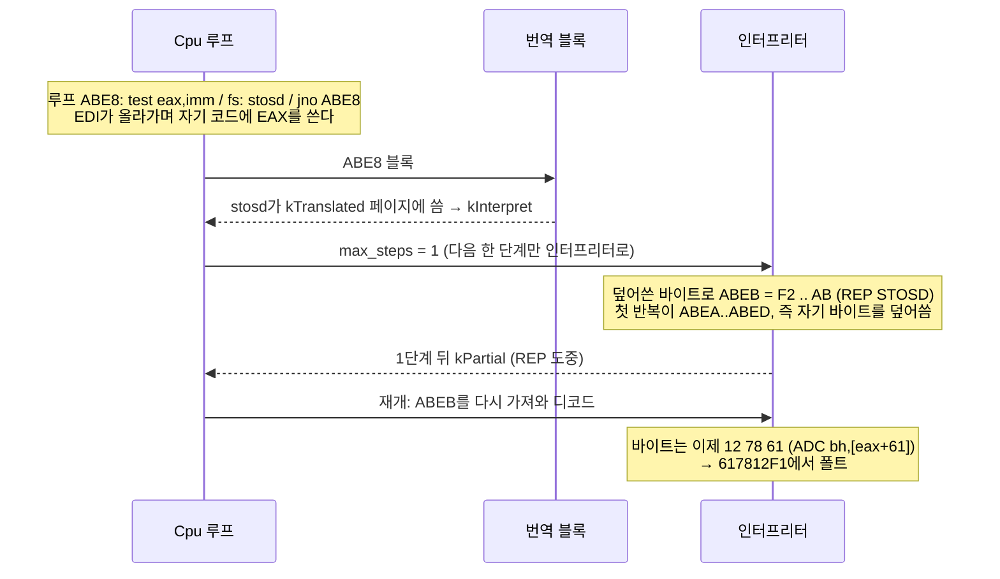

# #50 설계 : 진행 중인 REP 문자열의 재개와 wasm 캠페인 작업 / #50 design : resuming a REP string in progress, and the wasm campaign job

이슈: [#50](https://github.com/reexec/rex86/issues/50) | 근거: [#32 설계](20261010-i032-rep-string-budget.md) 결정 2, 3, 6, [#44 설계](20261010-i044-translation-runtime.md) 결정 1, [#46 설계](20261010-i046-translation-campaign.md) | 지시서: [20261011-i050](../work-orders/20261011-i050-rep-resume-and-wasm-campaign.md) | 로그: [20261011-i050](../work-logs/20261011-i050-rep-resume-and-wasm-campaign.md)

## 문제 1: I8 위반 / Problem 1: the I8 violation

v0.0.22 캠페인의 견고성 하네스가 `seed=2200826386`에서 I8 위반을 냈다. 번역과 인터프리터가 같은 사례를 다르게 실행했다는 뜻이다. 예산 12049인 실행에서 번역 쪽이 260단계 일찍, 다른 주소(`617812F1`, 인터프리터는 `0000B000`)에서 폴트를 낸다.

*The v0.0.22 campaign's robustness harness reported an I8 violation at `seed=2200826386`, translation and the interpreter running one case differently: in the run with budget 12049 translation faults 260 steps earlier and at another address (`617812F1` against the interpreter's `0000B000`).*

### 원인 / Cause

**확인됨**(Windows x64 MSVC Release에서 재현, 2026-10-11, [로그](../work-logs/20261011-i050-rep-resume-and-wasm-campaign.md)):

1. 사례의 루프는 `test eax, imm` / `fs: stosd` / `jno`이다. EDI가 4씩 올라가며 EAX를 쓰다가 자기 코드(`ABE8`~`ABF0`)를 덮어쓴다.
2. 덮어쓴 뒤의 코드 경로에서 `ABEB`에 REP STOSD(`F2 65 64 AB`)가 생긴다. 이 명령의 첫 반복은 `ABEA..ABED`, 즉 자기 바이트를 덮어쓴다.
3. 인터프리터만 쓰면 이 REP는 끊기지 않고 끝까지 돌아 `B000`(메모리 끝)에서 폴트를 낸다.
4. 번역을 켜면, 번역 블록이 `kTranslated` 페이지에 쓰려다 빠져나온 뒤 `Cpu` 루프가 "다음 한 단계는 인터프리터"를 `max_steps = 1`로 실행한다(#44 결정 1). #32부터 REP는 반복 하나가 한 단계라서 **REP가 첫 반복 뒤에 `kPartial`로 끊긴다**.
5. 재개할 때 인터프리터는 `ABEB`를 **메모리에서 다시 가져와 디코드**한다. 바이트가 이미 `12 78 61`(ADC)로 바뀌었으므로 다른 명령을 실행해 `617812F1`에서 폴트를 낸다.

**확인됨**(단위 테스트): 번역 없이도 같은 일이 생긴다. 자기 바이트를 덮어쓰는 `rep stosb`를 `rep_budget_test`의 분할 동등성 검사에 넣으면, 예산 1과 2로 나눠 돌린 결과가 한 번에 돌린 결과와 다르다(단계 수와 레지스터). 그래서 결함은 번역기가 아니라 **#32의 재개 방식**에 있다. #32 결정 6("REP를 단계로 나눠 실행해도 최종 상태는 끝까지 한 번에 실행한 것과 같아야 한다")을 어긴다. 번역기는 호스트에게 보이지 않는 내부 경계를 더 만들어 이것을 드러냈다.

*Confirmed (reproduced on Windows x64 MSVC Release, 2026-10-11, log): the case's loop (`test eax, imm` / `fs: stosd` / `jno`) stores EAX with EDI rising by 4 until it overwrites its own code (`ABE8` to `ABF0`); the overwritten path puts a REP STOSD (`F2 65 64 AB`) at `ABEB`, whose first iteration overwrites `ABEA..ABED`, its own bytes. The interpreter alone runs that REP uninterrupted to a fault at `B000` (the end of memory). With translation on, after a translated block exits at a store into a `kTranslated` page, the `Cpu` loop runs "the next step on the interpreter" as `max_steps = 1` (#44 decision 1); from #32 a REP iteration is a step, so the REP stops `kPartial` after its first iteration, and resuming fetches and decodes `ABEB` from memory again, now `12 78 61` (ADC), which faults at `617812F1`. Confirmed (unit test): the same happens without translation; a self-overwriting `rep stosb` added to `rep_budget_test`'s split-equivalence check ends differently in budgets of 1 and 2 than at once (steps and registers). The defect is therefore #32's way of resuming, against its decision 6 (a REP run in steps must end where running it at once does); translation only exposed it by adding internal boundaries the host never sees.*

### 왜 다른 차등이 놓쳤나 / Why the other differentials missed it

* **IR 차등**(`rex86_irdiff`): 프런트엔드는 REP 문자열을 번역하지 않는다. 차등은 형태와 블록을 한 번에 끝까지 돌리므로 REP 도중의 경계가 없다.
* **호스트 대조 fuzz의 번역 재생**(`int_fuzz --translate`): 명령 하나를 큰 예산으로 돌린다. 사례가 자기 코드를 덮어쓰지 않는다.
* **견고성 하네스**만 무작위 예산, 코드 수프, 자기 수정, 번역 경계를 한 사례에 함께 둔다. 이 조합이 드물어 100만 건에 1건이었다.

*The IR differential runs forms and blocks to their end at once and the frontend translates no REP string, so no boundary falls inside a REP; the host fuzz's translation replay runs single instructions on large budgets and its cases do not overwrite their own code; only the robustness harness combines random budgets, code soup, self-modification and translation boundaries in one case, rare enough to show once in a million.*

## 결정 1: 진행 중인 REP는 시작한 디코드로 재개한다 / Decision 1: a REP in progress resumes with the decode it started with

**근거(사양)**: SDM Vol. 2B의 REP 항목에 따르면, 예외나 인터럽트로 중단된 반복 문자열은 EIP가 명령 자신을 가리키고, 처리기에서 돌아오면 그 명령을 다시 가져와 이어 간다(#32의 근거 절). 처리기를 거치면 다시 가져오는 것이 하드웨어의 동작이다. 반면 `kPartial`이 생기는 경계(예산 소진, 정지 요청, 번역기의 내부 경계)는 하드웨어에 없는 에뮬레이터의 경계다. 이 경계에서 결과가 달라지면 안 된다(#32 결정 6). 그래서 다음처럼 나눈다.

*Basis (specification): per the SDM Vol. 2B REP entry, a repeated string suspended by an exception or interrupt leaves EIP at the instruction, and returning from the handler fetches it again and continues (#32's basis section); re-fetching after a handler is the hardware's behavior. The boundaries that make `kPartial` (budget exhaustion, a stop request, translation's internal boundary) are the emulator's, absent from the hardware, and must not change results (#32 decision 6). Hence:*

| 경계 | 지금 | 바뀐 뒤 |
|---|---|---|
| `kPartial`(예산, 정지 요청, 번역기의 한 단계) 뒤, 같은 선형 EIP에서 아무 명령도 실행하지 않고 재개 | 다시 가져와 디코드 | **저장한 디코드로 이어 감** |
| 인터럽트 전달(반복 사이의 attention), 처리기 실행 뒤 IRET로 복귀 | 다시 가져옴 | 그대로(처리기의 단계가 저장을 지움) |
| REP 도중 폴트, 거절된 포트(`kStopped`) 뒤 재실행 | 다시 가져옴 | 그대로(호스트가 처리기 역할) |
| 호스트가 그사이 EIP나 CS를 바꿈 | 다시 가져옴 | 그대로(선형 주소나 모드가 달라 저장을 버림) |

* **저장**: REP 문자열이 `kPartial`로 끝날 때, 그 명령의 디코드 결과를 `StepBudget`이 건네는 칸에 복사한다. `kPartial`은 `Run` 한 번에 많아야 한 번 생기므로, 복사(약 1 KB)는 반복마다가 아니라 경계마다 한 번이다. `Cpu`는 이 칸을 처음 필요할 때 만든다.
* **재개**: `Cpu` 루프에서 `in_progress_`이고 현재 선형 EIP가 기억한 주소와 같으며 CS의 모드(16/32비트)가 디코드 때와 같으면, 첫 단계를 저장한 디코드로 실행한다(`BlockLimits`의 새 칸 `resume`). 그 뒤로는 평소의 블록 루프다. 첫 단계를 루프 밖에서 따로 실행해, 핫 루프(#35)에는 분기가 늘지 않는다.
* **지움**: 단계를 하나라도 실행하면(`in_progress_`가 풀리면) 저장도 무효다. 지금의 게이트 처리(#32 결정 3)와 같은 조건이다.
* **호스트가 그사이 코드를 고친 경우**: 저장한 디코드로 이어 간다. 이미 시작한 명령은 가져온 것으로 본다. 다시 가져오게 하려면 호스트는 EIP를 바꾸거나 명령이 끝난 뒤에 고친다. 헤더 주석에 적는다.

*Saving: when a REP string ends `kPartial`, its decode is copied into a slot `StepBudget` lends; `kPartial` happens at most once per `Run`, so the copy (about 1 KB) costs once per boundary, not per iteration, and the `Cpu` makes the slot when first needed. Resuming: when the `Cpu` loop finds `in_progress_`, the current linear EIP equal to the remembered one and CS's mode (16/32-bit) the decode's, the first step runs the saved decode (a new `BlockLimits` field, `resume`), the ordinary block loop following; that first step runs outside the loop, so the hot loop (#35) gains no branch. Clearing: running any step (releasing `in_progress_`) invalidates the save, the condition #32 decision 3 already uses for gates. A host editing the code meanwhile: the saved decode continues, an instruction once started counting as fetched; a host wanting a re-fetch changes EIP or edits after the instruction ends, as the header comment states.*

### 번역기 쪽 / On the translation side

번역기의 `max_steps = 1`은 그대로 둔다. 결정 1로 REP 도중의 경계가 결과를 바꾸지 않게 되기 때문이다. "다음 명령 하나를 끝까지" 실행하도록 바꾸는 방법도 있다. 하지만 그러면 번역기에만 있는 우회가 되고, 예산이나 정지 요청의 경계는 그대로 남는다. 그래서 택하지 않는다.

*Translation's `max_steps = 1` stays: with decision 1 a boundary inside a REP no longer changes results. Running "the next instruction to its end" instead would be a workaround for translation alone and would leave the budget and stop-request boundaries as they are.*

## 결정 2: wasm 캠페인 작업 / Decision 2: the wasm campaign job

v0.0.22, v0.0.23, v0.0.24 캠페인에서 `wasm-translate`의 "IR differential through wasm" 단계가 세 번 모두 18~19분 뒤 러너 종료로 끝났다. 로그는 남지 않았다. 이 단계는 `node`로 `rex86_irdiff.js --cases 500000`을 shard 4개로 **동시에** 돌린다.

*In the v0.0.22, v0.0.23 and v0.0.24 campaigns, `wasm-translate`'s "IR differential through wasm" step ended all three times in a runner shutdown after 18 to 19 minutes, leaving no log; the step runs `rex86_irdiff.js --cases 500000` under `node` in four **concurrent** shards.*

**확인됨**(측정, AMD Ryzen 5 5600X, Windows 11, 같은 빌드, shard 하나 `--seed 2390000000`, [로그](../work-logs/20261011-i050-rep-resume-and-wasm-campaign.md)):

| Node | 결과 | 시간 | 최대 메모리 |
|---|---|---|---|
| 24.19.0 | 50만 건, 불일치 0 | 137초 | 168 MB |
| 20.18.0 | 25분에 끊음. 형태 단계(50만 건)도 끝나지 않음 | 1,500초 넘음 | 4,418 MB, 끊을 때까지 증가 |

* Node 20에서는 생성 모듈을 만드는 동안 메모리가 줄지 않고 늘어난다. 같은 빌드가 Node 24에서는 120 MB 안팎에 머문다. 그래서 rex86 쪽의 누수가 아니라, Node 20의 V8이 버린 wasm 모듈의 코드 메모리를 제때 회수하지 못하는 것으로 본다(추정). 원인의 V8 쪽 위치는 미확정이다.
* 캠페인 작업은 `setup-emsdk` 뒤에 Node를 따로 설치하지 않았다. 그래서 `node`는 러너 이미지의 기본 Node였다(로그에 판이 남지 않음. ubuntu-latest 이미지의 기본은 Node 20이다, 추정). emsdk의 `EMSDK_NODE`도 20.18.0이다.
* shard 넷이 각각 4 GB를 넘으면 합이 16 GB 러너의 메모리를 넘는다. 그러면 러너가 끊기고 로그가 남지 않는다. 세 번의 증상과 맞는다(추정).

*Confirmed (measured on an AMD Ryzen 5 5600X, Windows 11, one build, one shard with `--seed 2390000000`, log): under Node 24.19.0 the 500,000 cases finish without a mismatch in 137 seconds at 168 MB peak; under Node 20.18.0 it was stopped at 25 minutes without finishing even the forms phase, memory at 4,418 MB and still rising. Under Node 20 memory grows while generated modules are made, where Node 24 holds the same build near 120 MB, so the cause is taken to be Node 20's V8 not reclaiming dropped wasm modules' code memory in time rather than a leak in rex86 (inferred; where in V8 is unresolved). The campaign job installed no Node after `setup-emsdk`, so `node` was the runner image's default (the log keeps no version; ubuntu-latest's default is Node 20, inferred), and emsdk's `EMSDK_NODE` is 20.18.0 too. Four shards each passing 4 GB exceed a 16 GB runner, which then drops and leaves no log, matching all three occurrences (inferred).*

**결정**: `wasm-translate` 작업에 `actions/setup-node`로 Node 24를 설치한다. `browsers` 작업과 같은 판이다. 규모(shard당 50만 건)는 그대로 둔다. Node 24에서 shard 하나가 2분 남짓, 메모리 200 MB 아래이므로 여유가 크다. 보통 CI의 `wasm32` 작업은 ctest 규모(IR 차등 2만 건)라 바꾸지 않는다.

*Decision: the `wasm-translate` job installs Node 24 with `actions/setup-node`, the `browsers` job's version, keeping the scale (500,000 cases per shard): a shard takes about two minutes under 200 MB on Node 24, leaving ample room. The ordinary CI's `wasm32` job runs at ctest scale (20,000 IR differential cases) and stays as is.*

## 검증 / Verification

* **단위 테스트**:
  * `rep_budget_test`의 분할 동등성 목록에 자기 바이트를 덮어쓰는 REP를 넣는다. STOSB(앞으로), STOSD(DF=1로 뒤로), MOVSB(원본이 자기 바이트)다. 예산 1, 2, 7로 나눠도 한 번에 돌린 것과 같아야 한다.
  * 같은 프로그램을 번역(평가기, 문턱 0)으로 돌린 결과가 인터프리터와 같아야 한다.
  * 재개 경계: 저장 뒤 호스트가 EIP를 바꾸면 다시 가져온다. CS의 모드가 바뀌어도 다시 가져온다.
  * `robust_test`에 `seed=2200826386`을 회귀 사례로 고정한다(I6와 I8).
* **기존 모음**: 다섯 호스트 ctest, trace 묶음, SST, 견고성 smoke, IR 차등이 그대로 통과한다. REP 아닌 명령의 경로는 바뀌지 않는다.
* **성능**: 벤치마크의 `string`과 `mixed`를 바꾸기 전후로 잰다. 저장은 경계마다 한 번이므로 잡음 범위 안이어야 한다.
* **캠페인**: 이 판의 tag 캠페인에서 robust-release와 wasm-translate가 녹색이어야 한다.

*Unit tests: self-overwriting REPs join `rep_budget_test`'s split-equivalence list (STOSB forward, STOSD backward with DF=1, MOVSB reading its own bytes), equal at once and in budgets of 1, 2 and 7; the same programs under translation (evaluator, threshold 0) equal the interpreter; a host changing EIP, or CS's mode, after the save gets a re-fetch; `robust_test` pins `seed=2200826386` (I6 and I8). The existing suites (five-host ctest, the trace corpus, SST, robustness smoke, IR differential) pass unchanged, the path of non-REP instructions not changing. Performance: the benchmark's `string` and `mixed` measured before and after, the save happening once per boundary and expected within the noise. Campaign: this version's tag campaign has robust-release and wasm-translate green.*

## 소비자 영향 / Consumer impact

* 공개 계약(`include/rex86/`)의 함수와 형은 바뀌지 않는다. `Cpu::InstructionInProgress()`의 의미도 같다.
* 의미가 바뀌는 곳은 하나다. REP가 `Run` 경계에서 끊긴 뒤 호스트가 **EIP를 그대로 두고 그 명령의 바이트를 고친** 경우, 지금은 고친 바이트를 실행하고 바뀐 뒤에는 시작한 명령을 이어 간다. 두 소비자(rePIU, re2DJ)의 HLE는 실행 중인 REP의 바이트를 고치지 않으므로 영향이 없다고 본다(추정).
* 번역을 켠 소비자에게는 #50의 결함이 사라진다. v0.0.22~v0.0.24에서 번역을 켠 경우의 영향이 이것으로 끝난다.

*The public contract's functions and types (`include/rex86/`) do not change, nor does `Cpu::InstructionInProgress()`'s meaning. One meaning changes: after a REP stopped at a `Run` boundary, a host that **edits that instruction's bytes leaving EIP alone** now sees the started instruction continue rather than the edited bytes run; neither consumer's HLE (rePIU, re2DJ) edits a running REP's bytes, so no effect is expected (inferred). Consumers with translation on lose #50's defect, which ends the impact on v0.0.22 to v0.0.24 with translation on.*
