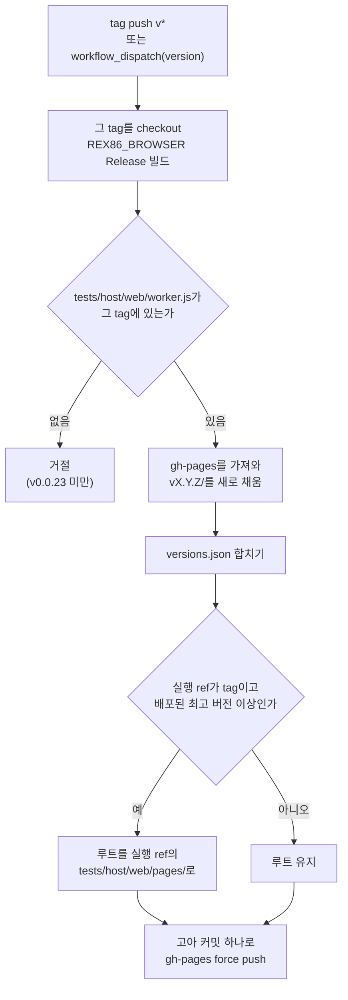
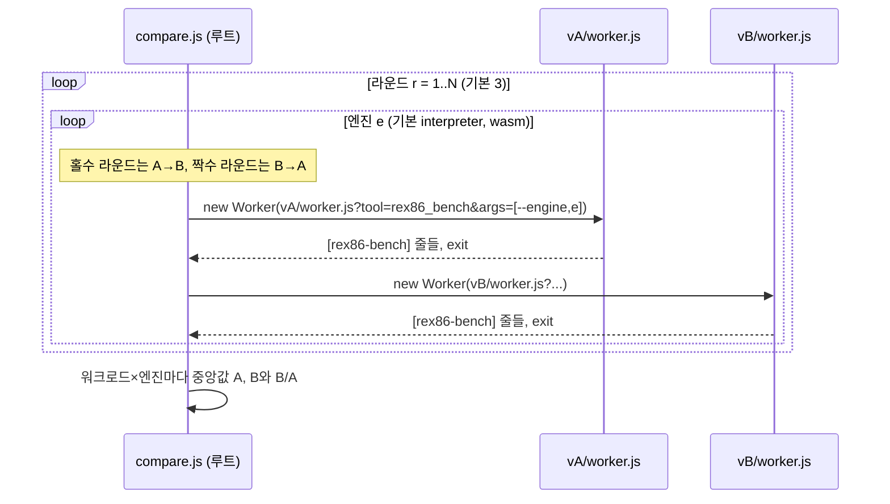

# #52 설계 : GitHub Pages의 버전별 브라우저 테스트와 벤치마크 비교 / #52 design : versioned browser tests and benchmark comparison on GitHub Pages

이슈: [#52](https://github.com/reexec/rex86/issues/52) | 근거: [#48 설계](20261011-i048-browser-validation.md) 결정 3, [#27 설계](20261009-i027-benchmark-harness.md), [브라우저의 wasm 번역](../analysis/browser-wasm.md) 5절 | 지시서: [20261011-i052](../work-orders/20261011-i052-pages-browser-tests.md) | 로그: [20261011-i052](../work-logs/20261011-i052-pages-browser-tests.md)

## 문제 / Problem

#48의 실기기 확인([가이드](../guides/browser-tests.md) 3절)을 하려면 개발 기계에서 emsdk로 브라우저용 빌드를 만들고, LAN에서 정적 서버를 띄워야 한다. 그래서 휴대폰으로 확인하기가 번거롭고, 기록 5절(실기기)은 아직 비어 있다. 또 벤치마크의 MIPS는 기기마다 다르다. 그래서 버전 사이의 개선을 보려면 같은 기기에서 두 버전을 함께 재야 한다. 지금은 그 수단이 없다.

*#48's real-device check (guide section 3) needs a browser build made with emsdk on a development machine and a static server on the LAN, which makes checking from a phone cumbersome, and section 5 of the record (real devices) is still empty. The benchmark's MIPS also differ by device, so an improvement between versions shows only when both versions are measured on one device, and nothing does that today.*

사용자 결정(2026-10-11, [#52](https://github.com/reexec/rex86/issues/52)):

1. 버전마다 보관하고 비교한다.
2. 휴대폰에서는 벤치마크를 기본으로 돌리고, 검증 모음 전체는 선택해서 돌린다.
3. tag push 때 배포하고, 이미 있는 v0.0.23은 한 번 채워 넣는다.

*User decisions (2026-10-11, #52): keep and compare every version; benchmark by default on phones, the whole suite optional; deploy on tag push, backfilling the existing v0.0.23 once.*

이 페이지는 README 목표 5의 웹 실행 예제가 아니다. 검증 도구를 공개 주소에 둔 것이다. 도구는 실행 중에 만든 합성 코드만 돌리고, 사용자의 입력을 게스트로 받지 않는다. 목표 5(엔진 선택과 처리량을 보여 주는 공개 예제)와 그 전제인 목표 6은 그대로 남는다.

*This page is not README goal 5's web demo but the verification tools at a public address: they run only synthetic code generated at run time and take no user input as a guest. Goal 5 (a public demo showing the engine choice and throughput) and its precondition, goal 6, stay open.*

## 결정 1: 사이트 구조 / Decision 1: the site layout

주소는 `https://reexec.github.io/rex86/`다. 배포 원본은 `gh-pages` 브랜치의 루트다.

*The address is `https://reexec.github.io/rex86/`, served from the root of the `gh-pages` branch.*

```text
/                    루트: 최신 tag의 tests/host/web/pages/ / root: the newest tag's tests/host/web/pages/
  index.html         버전 목록 / the version list
  compare.html       두 버전 벤치마크 비교 / the two-version benchmark comparison
  compare.js
  report.mjs         루트가 쓰는 보고 함수(최신 tag의 사본) / the root's report functions (the newest tag's copy)
  versions.json      배포된 버전 목록 / the deployed versions
  .nojekyll
  v0.0.23/           그 tag의 실행기와 빌드 / that tag's runner and build
    index.html suite.js worker.js main.html report.mjs
    bin/             REX86_BROWSER 빌드의 도구들 / the REX86_BROWSER build's tools
  v0.0.24/
  ...
```

* **버전 디렉터리는 그 tag의 소스로만 만든다.** 실행기 파일(`tests/host/web/`의 `index.html`, `suite.js`, `worker.js`, `main.html`, `report.mjs`)과 빌드가 같은 커밋에서 온다. 그래서 각 버전 페이지는 그 버전의 #48 실행기를 그대로 보여 준다. 한 번 올린 버전 디렉터리는 바꾸지 않는다. 같은 버전을 다시 배포할 때만 통째로 바꾼다.
* **루트는 배포된 버전 가운데 가장 높은 버전의 tag에서만 갱신한다.** 루트 파일은 새 디렉터리 `tests/host/web/pages/`에 둔다. 낮은 버전을 채워 넣는 배포는 루트를 건드리지 않는다.
* `versions.json`은 `[{ "version": "0.0.23", "commit": "<sha>", "date": "<ISO 8601>" }]`이고, 버전이 높은 순서로 둔다. 배포할 때마다 기존 목록에 합쳐 다시 쓴다.
* GitHub Pages는 응답 헤더를 정할 수 없다. 그래서 교차 출처 격리(COOP/COEP)를 켤 수 없다. 모음은 `SharedArrayBuffer`를 쓰지 않으므로 동작에는 지장이 없다. 다만 Firefox의 `performance.now()`가 1 ms 단위로 남는다. 따라서 Firefox의 `install_us_per_module`은 믿지 않는다([기록](../analysis/browser-wasm.md) 4절). 초 단위로 재는 MIPS에는 영향이 작다.

*A version directory is built from its tag's source alone: the runner files (`index.html`, `suite.js`, `worker.js`, `main.html` and `report.mjs` from `tests/host/web/`) and the build come from one commit, so each version page shows that version's #48 runner as is; once deployed it does not change, short of a redeploy of the same version replacing it whole. The root is refreshed only from the tag of the highest deployed version; its files live in a new directory, `tests/host/web/pages/`, and a backfill of a lower version leaves it alone. `versions.json` holds `[{ "version", "commit", "date" }]` with the highest version first, merged and rewritten on every deployment. GitHub Pages cannot set response headers, so cross-origin isolation (COOP/COEP) is not available; the suite uses no `SharedArrayBuffer` and runs unaffected, but Firefox keeps `performance.now()` at 1 ms, so its `install_us_per_module` stays untrusted (record section 4), MIPS measured over seconds being barely affected.*

## 결정 2: 배포 작업 / Decision 2: the deployment workflow

새 워크플로 `.github/workflows/pages.yml`이 배포를 맡는다.

*A new workflow, `.github/workflows/pages.yml`, deploys.*



* **시점**: `v*` tag push 때 돈다. `workflow_dispatch`도 받는다. 입력 `version`(예: `0.0.23`)을 주면 그 tag를 빌드해 그 디렉터리만 채운다. 이것으로 v0.0.23을 채워 넣는다. 실행기가 없는 v0.0.23 미만 tag는 거절한다.
* **빌드**: CI `browsers` 작업과 같은 emsdk 3.1.74, `-DREX86_BROWSER=ON` Release 빌드다. 배포 작업은 테스트를 다시 돌리지 않는다. 정확성은 CI와 tag 캠페인이 맡는다.
* **루트의 출처**: 루트 파일은 워크플로 실행 ref(tag push라면 그 tag, dispatch라면 선택한 ref)의 `tests/host/web/pages/`에서 가져온다. 실행 ref가 tag이고 그 버전이 배포된 최고 버전 이상일 때만 루트를 바꾼다. 그래서 루트에는 항상 릴리스된 tag의 파일만 올라간다. v0.0.23을 채워 넣을 때는 v0.0.24 tag를 ref로 골라 dispatch하면 루트도 함께 생긴다.
* **이력**: `gh-pages`는 배포 때마다 고아 커밋 하나로 force push한다. 바이너리가 버전마다 쌓이므로, 커밋 이력까지 쌓으면 저장소가 계속 커진다. 이전 배포의 내용은 tag와 이 워크플로로 다시 만들 수 있다.
* **동시 실행**: `concurrency: pages`로 배포를 한 번에 하나씩 돌리고, 앞선 배포를 취소하지 않는다. 그래야 두 tag가 같이 push되어도 서로의 디렉터리를 지우지 않는다.
* **권한**: `contents: write`만 쓴다. 외부 배포 액션 없이 `git` 명령으로 push한다.
* **Pages 설정**: 저장소 설정에서 원본을 `gh-pages` 브랜치의 `/`로 한 번 정한다. 저장소 관리자가 한다(작업 로그에 남긴다).

*It runs on `v*` tag pushes and on `workflow_dispatch`, whose input `version` (such as `0.0.23`) builds that tag and fills its directory alone, the way v0.0.23 is backfilled; tags below v0.0.23, which lack the runner, are refused. The build is CI `browsers`' emsdk 3.1.74 Release build with `-DREX86_BROWSER=ON`; deployment reruns no tests, correctness belonging to CI and the tag campaign. The root's files come from `tests/host/web/pages/` at the workflow's run ref (the tag for a tag push, the chosen ref for a dispatch), and the root changes only when the run ref is a tag whose version is at least the highest deployed one, so only released tags' files ever reach it; backfilling v0.0.23 by a dispatch on the v0.0.24 tag creates the root as well. `gh-pages` is force-pushed as a single orphan commit each time: binaries pile up per version and a history of them would keep growing the repository, while any earlier deployment can be rebuilt from its tag and this workflow. `concurrency: pages` runs deployments one at a time without cancelling, so two tags pushed together do not erase each other's directories. It uses `contents: write` alone and pushes with `git`, without an outside deployment action. The Pages source is set once, in the repository settings, to the `/` of `gh-pages`, by a repository administrator (noted in the work log).*

### 크기 예산 / Size budget

GitHub Pages 사이트의 권장 한도는 1 GB다([GitHub 문서](https://docs.github.com/en/pages/getting-started-with-github-pages/github-pages-limits)). 버전 디렉터리 하나의 크기는 **미확정**이다. 구현에서 v0.0.23으로 재서 작업 로그에 적는다. 워크플로는 배포 뒤 사이트 전체 크기를 작업 요약에 적는다. 합이 500 MB를 넘으면 가장 오래된 버전부터 지워 500 MB 아래로 맞추고, `versions.json`에서도 뺀다. 지운 버전은 그 tag로 다시 배포할 수 있다.

*GitHub Pages recommends sites under 1 GB (GitHub docs). One version directory's size is unresolved, to be measured on v0.0.23 during implementation and recorded in the work log. The workflow writes the whole site's size to the job summary; past 500 MB it removes the oldest versions until under 500 MB, dropping them from `versions.json` too, any of them redeployable from its tag.*

## 결정 3: 루트의 버전 목록 / Decision 3: the root's version list

`index.html`은 `versions.json`을 `cache: 'no-store'`로 읽는다. Pages는 10분 캐시를 두므로, 이렇게 해야 방금 배포한 버전이 보인다. 버전마다 한 줄을 보여 준다.

*`index.html` reads `versions.json` with `cache: 'no-store'` (Pages caches for ten minutes, and this shows a version just deployed) and shows a row per version:*

| 열 | 내용 |
|---|---|
| 버전 | `v0.0.24`, 날짜, 커밋 |
| 벤치마크 | `vX/index.html?only=bench-interpreter,bench-wasm`. 휴대폰의 기본 경로(사용자 결정 2) |
| 전체 모음 | `vX/index.html`. #48 모음 전체 |
| 릴리스 노트 | `https://github.com/reexec/rex86/blob/vX/docs/release-notes/vX.md` |

* 위에는 **비교** 링크를 둔다. 기본값은 최신 버전과 바로 아래 버전이다(결정 4).
* 쪽 아래에는 [가이드](../guides/browser-tests.md)로 가는 링크와, 결과를 어디에 보내는지(이슈 #52나 기록 5절) 적는다.
* 휴대폰 너비에서 가로 스크롤 없이 보이게 한다. 색은 #48의 `index.html`과 같은 토큰을 쓰고, 다크 모드를 따른다.

*Columns: the version (date and commit), the benchmark (`vX/index.html?only=bench-interpreter,bench-wasm`, the default path on phones, user decision 2), the whole suite (`vX/index.html`, #48's suite) and the release notes. A **Compare** link sits on top, defaulting to the newest version and the one below it (decision 4); the foot links the guide and says where results go (issue #52 or record section 5). It fits a phone's width without horizontal scrolling, using #48's `index.html` color tokens and following dark mode.*

## 결정 4: 두 버전 비교 / Decision 4: comparing two versions

`compare.html?a=0.0.23&b=0.0.24`는 같은 기기에서 두 버전의 `rex86_bench`를 번갈아 돌린다. 그리고 워크로드마다 중앙값과 비율을 보여 준다.

*`compare.html?a=0.0.23&b=0.0.24` runs the two versions' `rex86_bench` alternately on one device and shows medians and ratios per workload.*



* **입력**: 버전 A와 B(`versions.json`의 목록, 기본은 바로 아래 버전과 최신), 엔진(interpreter와 wasm은 켜고 evaluator는 끈다), 라운드 수(1~5, 기본 3). 시작 버튼을 눌러야 돈다. 휴대폰에서 실수로 오래 도는 일을 막기 위해서다.
* **순서**: 라운드마다 앞서는 버전을 바꾼다(ABBA). 휴대폰이 달아오르며 느려지는 영향이 한 버전에 몰리지 않게 하기 위해서다. 실행 사이에는 2초를 기다린다. 벤치마크의 wasm 실행은 모듈을 수십 개만 만든다. 그래서 #48의 Firefox 모듈 수 한도(1만 6천 개 남짓)와는 거리가 멀다.
* **실행**: 각 버전의 `worker.js`를 그 디렉터리 경로로 띄운다. Worker 안의 `bin/` 상대 경로는 Worker 스크립트 주소를 기준으로 풀리므로, 각 버전은 자기 빌드를 읽는다. 루트는 출력을 읽기만 한다.
* **확인**: 출력의 `[rex86-bench] version=` 값이 고른 버전과 다르면 그 실행을 실패로 센다. 이전 배포가 캐시에 남은 경우를 잡기 위해서다. `verified=fail`인 워크로드도 실패다. `engine_available=false`(그 버전에 그 엔진이 없음)는 "—"로 보인다.
* **표시**: 엔진마다 표를 하나 둔다. 행은 워크로드이고, 열은 A 중앙값, B 중앙값, B/A다. B/A가 1.05 이상이면 개선 색, 0.95 이하이면 후퇴 색을 쓴다. 이 경계는 #27의 반복 측정 변동(몇 %)을 넘는 차이만 표시하려는 것이다. 판정이 아니라 눈으로 보기 위한 표시다. 각 실행의 값은 접힌 상세에 둔다.
* **보고**: #48과 같은 보고 칸과 **Copy report**를 둔다. 줄은 `[rex86-compare] user_agent="..."`, `[rex86-compare] a=0.0.23 b=0.0.24 engine=wasm workload=alu a_mips=... b_mips=... ratio=... runs=3`, `[rex86-compare] result=ok|fail`이다. 이 줄을 기록 5절에 더한다.
* 결과는 페이지에만 남는다. 서버로 보내지 않고 저장하지도 않는다. 기기 정보(모델, 전원)는 사람이 보고와 함께 적는다.

*Inputs: versions A and B (from `versions.json`, defaulting to the one below the newest and the newest), engines (interpreter and wasm on, evaluator off) and rounds (1 to 5, default 3); nothing runs until the start button, so a phone does not start a long run by accident. Each round swaps which version goes first (ABBA), so a phone heating up and slowing does not land on one version; runs are 2 seconds apart, the benchmark's wasm runs making a few dozen modules, far from Firefox's limit of some 16,000 (#48). Each version's `worker.js` starts at its directory's path; a Worker resolves `bin/` against its script's address, so each version reads its own build and the root only reads output. A run whose `[rex86-bench] version=` differs from the chosen version counts as failed, catching an earlier deployment left in a cache; a `verified=fail` workload fails too, and `engine_available=false` (the version lacks the engine) shows as a dash. One table per engine, workloads as rows, A's median, B's median and B/A as columns, colored as an improvement at 1.05 or more and a regression at 0.95 or less, a bound meant to mark only differences beyond #27's run-to-run variation (a few percent), a visual aid rather than a verdict; each run's figures sit in a collapsed detail. A report box and **Copy report** as in #48 give `[rex86-compare]` lines (user agent, one line per engine and workload with both medians, the ratio and the run count, and a result line) to add to record section 5. Results stay on the page, neither sent anywhere nor stored; the person adds the device details (model, power) with the report.*

### 루트와 버전 디렉터리 사이의 계약 / The contract between the root and version directories

루트는 최신 tag에서 오고, 버전 디렉터리는 각자의 tag에서 온다. 그래서 다음 세 가지를 앞으로의 버전에서도 유지한다. 바꿀 때는 루트가 옛 형식도 읽도록 해야 한다.

*The root comes from the newest tag and each version directory from its own, so these three hold in future versions as well, and changing one means teaching the root the old form too:*

1. `worker.js?tool=<도구>&args=<JSON 배열>`로 도구 하나를 띄운다.
2. Worker의 메시지는 `{ kind: 'out' | 'err' | 'exit', text, code }`다.
3. 벤치마크 줄은 `[rex86-bench] version=`, `[rex86-bench] workload=<이름> ... mips=<값> ... verified=ok`, `verified=fail`, `engine_available=false`다.

*1 `worker.js?tool=<tool>&args=<JSON array>` starts one tool; 2 the Worker's messages are `{ kind: 'out' | 'err' | 'exit', text, code }`; 3 the benchmark lines are `[rex86-bench] version=`, `[rex86-bench] workload=<name> ... mips=<value> ... verified=ok`, `verified=fail` and `engine_available=false`.*

`tests/host/web/worker.js`와 `src/tools/bench/main.cpp`의 주석에 이 계약을 적는다.

*The comments of `tests/host/web/worker.js` and `src/tools/bench/main.cpp` state this contract.*

## 결정 5: 검증 / Decision 5: verification

* **로컬**: `serve.mjs`에 사이트 디렉터리를 그대로 내주는 모드(`--site <디렉터리>`)를 더한다. 버전 디렉터리 둘(같은 빌드를 두 이름으로 둔 것)과 루트를 조립해 띄우고, Playwright로 다음을 확인한다.
  * 버전 목록이 보인다.
  * 벤치마크 링크가 돈다.
  * 비교가 끝나고 `[rex86-compare] result=ok`가 나온다.
  * 버전 이름이 출력의 `version=`과 다르면 실패로 센다.
* 조립 스크립트 `scripts/pages_site.sh`를 워크플로와 로컬 검증이 함께 쓴다. 인자는 사이트 디렉터리, 버전, 빌드 `bin/`, 실행기 디렉터리, 루트 디렉터리(선택)다.
* **CI**: CI `browsers` 작업에 위 비교 smoke를 더한다. 이 작업은 이미 브라우저용 빌드가 있으므로, 같은 빌드를 두 버전 이름으로 조립해 Chromium에서 `compare.html?rounds=1&frames=2`를 돌린다. 라운드와 프레임은 smoke용 쿼리다. `frames`는 `rex86_bench --frames`로 넘긴다.
* **배포 뒤**: tag push 뒤 Pages 주소에서 데스크톱 Chromium으로 목록, 벤치마크, 비교를 한 번 연다. 실기기 결과는 사용자가 돌린 뒤 기록 5절에 더한다.

*Locally, `serve.mjs` gains a mode serving a site directory as is (`--site <dir>`); a root and two version directories (one build under two names) are assembled and served, and Playwright checks that the version list shows, a benchmark link runs, and a comparison finishes with `[rex86-compare] result=ok`, a version name differing from the output's `version=` counting as a failure. The assembly script `scripts/pages_site.sh` (site directory, version, the build's `bin/`, the runner directory and optionally the root directory) is shared by the workflow and local verification. In CI the `browsers` job, which already has a browser build, adds this comparison smoke, assembling one build under two version names and running `compare.html?rounds=1&frames=2` in Chromium; rounds and frames are smoke queries, `frames` passed on as `rex86_bench --frames`. After deployment, the Pages address is opened once in desktop Chromium for the list, a benchmark and a comparison; real-device results join record section 5 once the user has run them.*

## 소비자 영향 / Consumer impact

없다. 코어와 공개 계약을 바꾸지 않는다. 바뀌는 것은 검증 도구, 워크플로, 문서다.

*None: neither the core nor the public contract changes, only the verification tools, workflows and documents.*

## 범위 밖 / Out of scope

* README 목표 5의 웹 실행 예제(4단계).
* 결과를 서버에 모으는 일. 결과는 사람이 보고 줄로 옮긴다.
* tag 캠페인의 결과를 페이지에 보이는 일. 버전 행에 릴리스 노트 링크만 둔다. 캠페인 결과는 다음 릴리스 노트의 검증 절에 있다.
* v0.0.23 미만 버전. 브라우저 실행기가 없다.

*Out of scope: README goal 5's web demo (phase 4); collecting results on a server (a person carries the report lines); showing the tag campaign's outcome on the page (the version row links the release notes only, and the campaign result is in the next release notes' verification section); versions below v0.0.23, which have no browser runner.*
