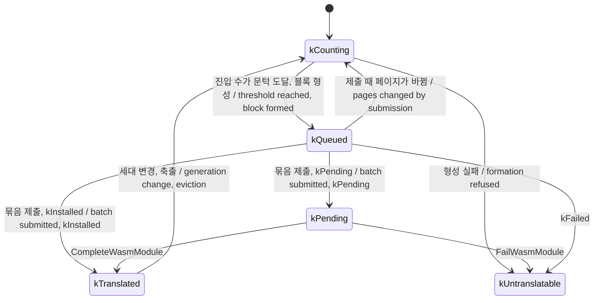

# #49 설계 : wasm 묶음 설치와 모듈 수 예산 / #49 design : batched wasm installation and a module count budget

이슈: [#49](https://github.com/reexec/rex86/issues/49) | 앞 설계: [#42](20261010-i042-phase3-translation.md) 결정 7, [#44](20261010-i044-translation-runtime.md), [#45](20261010-i045-wasm-backend.md), [#48](20261011-i048-browser-validation.md) | 기록: [브라우저의 wasm 번역](../analysis/browser-wasm.md) 3절 | 지시서: [20261012-i049](../work-orders/20261012-i049-wasm-module-batching.md) | 로그: [20261012-i049](../work-logs/20261012-i049-wasm-module-batching.md)

#48에서 Firefox가 한 프로세스에서 wasm 모듈 16,349개째부터 설치를 거절한다는 것을 확인했다. 지금의 wasm 백엔드(#45)는 블록 하나에 모듈 하나를 쓰므로, Firefox에서 번역은 1만 6천 블록 남짓으로 묶인다. 이 작업은 여러 블록을 모듈 하나로 묶어 설치하고, 살아 있는 모듈 수에 예산을 두어 넘으면 오래된 모듈을 통째로 축출한다. #42 결정 7이 처음부터 그린 "요청을 모아 모듈 하나로"를 실제로 만드는 작업이다.

*#48 confirmed that Firefox refuses wasm installation from the 16,349th module in a process. The current wasm backend (#45) makes one module per block, so in Firefox translation is bounded by some 16,000 blocks. This task installs several blocks per module and puts a budget on the number of live modules, evicting the oldest module whole beyond it: what #42 decision 7 sketched from the start ("gather requests into one module").*

## 결정 1: 한도는 모듈 수에 걸린다(사전 실험) / Decision 1: the limit counts modules (spike)

Playwright의 Firefox(Windows x64, Playwright 1.63.0의 firefox-1543), 2026-10-12. 함수 `funcs`개를 내보내고 함수마다 `(local.get, i32.const, i32.add, local.set)`을 `ops`번 반복하는 모듈을 `new WebAssembly.Module`과 `new WebAssembly.Instance`로 실패할 때까지 만들었다.

*Playwright's Firefox (Windows x64, Playwright 1.63.0's firefox-1543), 2026-10-12: modules exporting `funcs` functions, each repeating `(local.get, i32.const, i32.add, local.set)` `ops` times, created with `new WebAssembly.Module` and `new WebAssembly.Instance` until failure.*

| funcs | ops | 모듈 바이트 / module bytes | 실패까지 모듈 / modules to failure | 함수 / functions |
|---:|---:|---:|---:|---:|
| 1 | 20 | 179 | **16,349** | 16,349 |
| 1 | 400 | 3,219 | **16,349** | 16,349 |
| 16 | 20 | 2,501 | **16,349** | 261,584 |
| 64 | 20 | 10,179 | **16,349** | 1,046,336 |
| 1 | 2,000 / 3,000 / 4,000 | 16,019 / 24,003 / 32,003 | 9,000개까지 실패 없음 / no failure up to 9,000 | |
| 16 | 400 | 51,142 | **8,220** | 131,520 |

* **확인됨**: 한도는 모듈 수에 걸린다. 모듈 하나에 함수를 64개 넣어도 모듈 수 한도는 그대로이고, 설치할 수 있는 함수는 64배가 된다. #48(Linux)의 16,349와 같은 수다.
* **확인됨**: 모듈이 커지면(wasm 51 KB) 한도가 절반이 된다. wasm 32 KB까지는 줄지 않았다.
* **추정**: SpiderMonkey는 프로세스의 실행 메모리(64비트에서 1 GiB로 보인다)를 64 KiB 단위로 모듈에 나눠 준다. 1 GiB / 64 KiB = 16,384이고, 엔진 자신이 쓰는 몫을 빼면 16,349가 된다. 그래서 모듈의 기계어가 64 KiB 안이면 블록을 더 넣어도 비용이 없다. 실제 수치는 SpiderMonkey 소스(`ProcessExecutableMemory`)로 확인하지 않았다.

*Confirmed: the limit counts modules. With 64 functions per module the module limit stays and 64 times as many functions install; the count equals #48's on Linux. Confirmed: a larger module (51 KB of wasm) halves the limit, while up to 32 KB it did not shrink. Inferred: SpiderMonkey hands the process's executable memory (apparently 1 GiB on 64-bit) to modules in 64 KiB units, 1 GiB / 64 KiB = 16,384, less the engine's own share giving 16,349, so more blocks cost nothing while a module's machine code fits in 64 KiB; the figures were not checked in SpiderMonkey's source (`ProcessExecutableMemory`).*

## 결정 2: 묶음은 실행기가 모은다 / Decision 2: the runtime gathers batches



* 묶음은 백엔드가 아니라 번역 실행기(`Translator`)가 모은다. 블록이 문턱에 이르면 지금처럼 그 자리에서 IR을 만들고 최적화하고 페이지에 `kTranslated`를 붙인다. 그런 다음 바로 설치하지 않고 새 상태 `kQueued`로 묶음 대기열에 넣는다. 대기 중인 블록은 인터프리터가 돌린다(`kPending`과 같다).
* **제출 시점**: 대기열이 `blocks_per_module`개가 되었을 때, 또는 가장 오래된 블록이 대기열에 들어간 뒤 블록 진입(`Lookup`)이 `batch_wait`번 지났을 때. 시간이 아니라 진입 수로 재므로 호스트와 무관하게 결정적이다.
* **제출**: 대기열에서 페이지 세대가 바뀐 블록을 빼고(계수 상태로 돌아간다), 남은 블록을 한 번에 백엔드에 넘긴다. 묶음 하나에 티켓 하나다. 백엔드의 `Compile`은 번역의 배열을 받는다. 평가기는 묶음 크기 1을 알리므로 지금처럼 문턱에서 바로 준비된다.
* **비동기 응답**: `CompleteWasmModule(ticket, indices, count)`의 `indices[i]`는 묶음의 i번째 블록이다. 그 사이에 사라진 블록(무효화, 축출, `Flush`)의 칸은 `Release`로 돌려준다. `count`가 묶음 크기와 다르면 실패로 본다.
* **상한**: `blocks_per_module`은 1~64로 자른다. 64는 비동기 웹 어댑터의 내보내기 상한(`kMaxExports`)과 같다. 블록은 최대 64 명령이므로 묶음의 바이트에는 따로 상한을 두지 않는다. 결정 1에서 64 KiB 단위를 넘는 것은 정확성 문제가 아니라 단위 하나를 더 쓰는 비용이다. 실제 모듈 크기는 벤치마크가 보고한다(결정 5).
* 번역 강제 빌드(`REX86_FORCE_TRANSLATION=WASM`)는 `blocks_per_module = 1`을 쓴다. 강제 빌드의 목적은 모든 블록을 첫 진입에서 wasm으로 돌리는 것인데, 한 번만 도는 사례(trace, 견고성)는 묶음을 기다리면 번역으로 돌지 않기 때문이다. 묶음 경로는 단위 테스트, IR 차등(결정 5), 비동기 테스트, 벤치마크가 검증한다.

*The batch is gathered by the translation runtime (`Translator`), not the backend. A block reaching the threshold is formed, optimized and flagged `kTranslated` on its pages at once, as now, then joins the batch queue in a new state `kQueued` instead of being installed; the interpreter runs a queued block (as for `kPending`). Submission comes when the queue holds `blocks_per_module` blocks, or when `batch_wait` block entries (`Lookup`s) have passed since the oldest joined, counted in entries rather than time so that it is deterministic on every host. Submitting removes the blocks whose page generations changed (back to counting) and hands the rest to the backend at once, one ticket per batch; the backend's `Compile` takes an array of translations, and the evaluator announces a batch size of 1, so it is ready at the threshold as now. Asynchronous answers: `indices[i]` of `CompleteWasmModule(ticket, indices, count)` belongs to the batch's i-th block, slots of blocks gone meanwhile (invalidation, eviction, `Flush`) are given back through `Release`, and a `count` other than the batch's size counts as failure. `blocks_per_module` is clamped to 1 to 64, 64 matching the asynchronous web adapter's export cap (`kMaxExports`); a block has at most 64 instructions, so batches get no byte cap, crossing decision 1's 64 KiB unit costing one more unit rather than correctness, with real module sizes reported by the benchmark (decision 5). The forced-translation build (`REX86_FORCE_TRANSLATION=WASM`) uses `blocks_per_module = 1`: it exists to run every block on wasm from its first entry, and cases that run once (traces, robustness) would never run translated waiting for a batch; the batched path is verified by unit tests, the IR differential (decision 5), the asynchronous test and the benchmark.*

## 결정 3: 모듈 수 예산과 축출 / Decision 3: the module count budget and eviction

* 실행기는 제출한 묶음마다 모듈 기록(티켓, 구성 블록의 머리 주소, 살아 있는 구성 수)을 티켓 순서로 둔다. 구성 블록이 무효화, 축출, `Flush`로 사라지면 살아 있는 수가 줄고, 0이면 기록을 지운다.
* `max_modules`(0은 무제한): 새 묶음을 제출하기 전에 살아 있는 모듈(설치 대기 포함)이 예산에 이르면, 가장 오래된 모듈을 통째로 축출한다. 구성 블록은 모두 계수 상태로 돌아가고 테이블 칸은 `Release`된다. 다시 뜨거워지면 다음 묶음으로 다시 번역된다. 축출된 블록은 인터프리터로 돌므로 결과는 그대로다(README 목표 7: 축출이 정확성을 해치지 않는다).
* 축출 단위가 모듈인 이유: 모듈의 실행 메모리는 함수 하나라도 테이블에 남으면 돌아오지 않는다. 블록 하나만 축출하면 메모리는 그대로다.
* 순서는 설치 순서(FIFO)다. LRU는 실행 경로에 기록을 더해야 하므로, 측정으로 근거가 생긴 뒤에 본다.
* **축출 억제**(구현 중 측정으로 더함): 작업 집합이 예산보다 크면 FIFO 축출은 헛돈다. Node에서 `blocks` 워크로드를 묶음 1, 예산 4,096으로 돌리자, 블록마다 바퀴마다 다시 번역되어 모듈 76만 개를 설치했고 0.42 MIPS로 인터프리터(3.0)보다 훨씬 느렸다. 그래서 축출된 블록은 다시 번역되기까지 진입이 문턱의 2배, 4배, … 최대 64배(`kMaxEvictionShift` 6) 필요하다. 축출 횟수는 그 블록 항목에 남고, 코드가 바뀌어 버려질 때도 남으며, `Flush`에서만 지워진다. 같은 조건에서 설치는 11만 개, 1.7 MIPS가 되었다(결정 5의 측정). 문턱 0(번역 강제)에는 억제가 없다.
* **한계(추정)**: Firefox에서 버린 모듈의 메모리는 쓰레기 수집에서만 돌아온다(기록 3절). 예산은 살아 있는 코드를 묶을 뿐, 수집되지 않은 죽은 모듈은 묶지 못한다. 묶음은 모듈이 만들어지는 속도 자체를 `blocks_per_module`배 줄이므로 이것이 주된 대책이다. 자기 수정 코드로 같은 블록이 계속 다시 번역되는 경우의 재번역 억제(무효화마다 문턱을 올리기)는 이 작업에 넣지 않고 후속으로 남긴다. 측정할 소비자 게스트가 아직 없다.

*The runtime keeps a module record per submitted batch (its ticket, its blocks' heads, the count of members alive) in ticket order; a member gone through invalidation, eviction or `Flush` lowers the count, and at 0 the record goes. `max_modules` (0 for none): before a new batch is submitted, if the live modules (pending installations included) have reached the budget, the oldest module is evicted whole: its blocks all return to counting and their table slots are `Release`d, a block that heats up again being translated anew in a later batch. Evicted blocks run on the interpreter, so results do not change (README goal 7: eviction never harms correctness). The unit of eviction is the module because a module's executable memory does not return while any of its functions stays in the table; evicting one block frees nothing. The order is installation order (FIFO); LRU would add bookkeeping to the execution path and waits for a measurement to argue for it. Eviction backoff (added from a measurement during implementation): with a working set larger than the budget, FIFO eviction thrashes; on Node the `blocks` workload with one block per module and a budget of 4,096 re-translated every block every lap, installing 760,000 modules at 0.42 MIPS, far below the interpreter's 3.0. An evicted block therefore needs 2, 4, … up to 64 times the threshold in entries (`kMaxEvictionShift` 6) before it is translated again, the count staying in the block's entry, also when its code changes, and cleared only by `Flush`; under the same conditions 110,000 modules were installed at 1.7 MIPS (decision 5's measurement). A threshold of 0 (forced translation) has no backoff. Limit (inferred): in Firefox a dropped module's memory returns only at a garbage collection (record section 3), so the budget bounds live code but not dead modules awaiting collection; batching, cutting the rate at which modules are made by `blocks_per_module`, is the main remedy. Damping re-translation when self-modifying code keeps re-translating one block (raising its threshold at each invalidation) stays out of this task as a follow-up, with no consumer guest to measure yet.*

## 결정 4: 공개 계약 / Decision 4: the public contract

```cpp
struct TranslationOptions
{
    // ... (unchanged fields)
    // For kWasm: blocks installed together as one module (1 to 64), and the
    // block entries the oldest waits before a partial batch is submitted.
    std::uint32_t blocks_per_module = 16;   // chosen by measurement (decision 5)
    std::uint32_t batch_wait = 4096;        // chosen by measurement (decision 5)
    // For kWasm: live modules beyond which the oldest is evicted; 0 for none.
    std::uint32_t max_modules = 4096;       // provisional (README goal 7, phase 4)
};

struct TranslationStats
{
    // ... (unchanged fields)
    std::uint64_t modules_submitted = 0;  // batches handed to the backend
    std::uint64_t modules_evicted = 0;    // by the budget
};
```

* 필드만 더한다. `blocks_per_module` 16과 `batch_wait` 4,096은 결정 5의 측정으로 정했다. `max_modules`의 기본값 4,096은 임시이며, README 목표 7의 수치 상한과 함께 4단계에서 확정한다. 첫 후보는 1,024였으나, 묶음 16의 블록 2만 4천 개(모듈 1,537개)가 예산 안에 들도록 올렸다. 4,096 × 16 = 65,536은 실행기의 항목 한도와 같다.
* 묶음과 예산은 `kWasm`에만 적용한다. 평가기는 블록마다 바로 준비되고 모듈을 갖지 않는다. 구현 중 평가기에도 예산이 걸려 블록 1,024개에서 축출이 헛돈 것을 보고 뺐다.
* `WasmModuleServices`의 계약은 그대로다. `Install`의 `export_count`가 1보다 커질 뿐이고, 계약은 처음부터 여러 내보내기를 받았다.

*Fields are only added. `blocks_per_module` 16 and `batch_wait` 4,096 were chosen by decision 5's measurement; `max_modules`'s default of 4,096 is provisional, fixed with README goal 7's caps in phase 4, raised from a first candidate of 1,024 so that the 24,000 blocks of 16-block batches (1,537 modules) fit, 4,096 × 16 = 65,536 matching the runtime's entry cap. Batching and the budget apply to `kWasm` alone: the evaluator is ready block by block and holds no modules, the budget having been removed from it after it thrashed at 1,024 blocks during implementation. `WasmModuleServices`'s contract is unchanged: `Install`'s `export_count` merely exceeds 1, which the contract accepted from the start.*

## 결정 5: 측정과 도구 / Decision 5: measurement and tools

* **벤치마크 워크로드 `blocks`**: 별도 코드 영역(0x200000부터 256 KiB)에 서로 다른 블록 24,576개를 이어 두고(`add eax, imm8; jmp short`), 한 바퀴에 모두 지난다. 블록 수가 Firefox의 한도보다 크다. 다른 워크로드와 같이 C++ 기준 모델로 결과를 확인한다. 묶음 없이(`blocks_per_module = 1`) Firefox에서 설치 거절이 나고, 묶음으로 사라지는 것을 보인다.
* **벤치마크 보고**: 제출한 모듈 수, 축출 수, 설치 실패 수, 모듈 평균 바이트를 더한다. `--blocks-per-module`, `--batch-wait`, `--max-modules` 옵션으로 값을 바꿔 잰다.
* **기본값 고르기**: Node, Chromium, Firefox에서 `blocks_per_module` 1, 4, 16, 64와 `batch_wait` 256, 4096, 65536을 alu, call, mixed, blocks에 돌려 처리량, 설치 시간, 번역까지의 지연을 본다.
* **고른 값**(측정은 [기록](../analysis/browser-wasm.md) 3절): `blocks_per_module` 16. alu, call, mixed는 1~64 사이 차이가 편차 범위였다. `blocks`는 64가 조금 빨랐지만(Chromium 12.7 → 16.3, Firefox 8.8 → 10.4 MIPS) 설치 한 번이 Firefox에서 0.65 → 0.88 ms로 길고, 게임 블록은 이 워크로드의 두 명령보다 커서 64개면 결정 1의 64 KiB 단위를 넘기 쉽다. 16이면 Firefox 한도 안에서 블록 26만 개로, 실행기 한도(65,536)를 이미 넘는다. `batch_wait` 4,096: 65,536은 첫 번역을 늦췄고(Chromium alu 첫 프레임 21 → 61 ms), 256은 이득이 없었다.
* **IR 차등**: wasm 비교를 `--wasm-batch`(기본 16)개씩 모아 모듈 하나로 설치하고 각 블록을 돌린다. 여러 함수를 내보내는 모듈이 실제로 맞게 도는지 차등이 확인하고, 만드는 모듈 수가 그만큼 줄어든다.
* **브라우저 모음**: IR 차등 제한(5,000건)을 Node와 같은 2만 건으로 올렸다. Firefox에서 테스트 사이 대기 0으로 모음이 세 번 모두 통과해, 기본 대기를 5초에서 1초로 줄였다(재시도 장치는 남김).
* **모듈 한도 탐침**: 결정 1의 실험을 `tests/host/web/module_limit.html`로 둔다. CI의 WebKit(JavaScriptCore)에서 한 번 돌려 한도를 기록하고, 실기기 Safari는 가이드 3절로 사용자가 잰다.

*Benchmark workload `blocks`: 24,576 distinct blocks chained in a separate code region (256 KiB from 0x200000, `add eax, imm8; jmp short`), all passed once per lap, more blocks than Firefox's limit, checked against a C++ reference model like every workload; without batching (`blocks_per_module = 1`) Firefox refuses installations, which batching should remove. The benchmark reports modules submitted, evictions, failed installations and mean module bytes, with `--blocks-per-module`, `--batch-wait` and `--max-modules` to vary them. Choosing the defaults: `blocks_per_module` 1, 4, 16, 64 and `batch_wait` 256, 4096, 65536 on Node, Chromium and Firefox over alu, call, mixed and blocks, looking at throughput, installation time and the delay to translation. Chosen values (measurements in record section 3): `blocks_per_module` 16, alu, call and mixed differing within noise from 1 to 64, and on `blocks` 64 being slightly faster (Chromium 12.7 to 16.3, Firefox 8.8 to 10.4 MIPS) but installing at 0.65 to 0.88 ms per module in Firefox, game blocks being larger than this workload's two instructions so 64 of them would easily pass decision 1's 64 KiB unit, while 16 already allows 260,000 blocks within Firefox's limit, beyond the runtime's 65,536 entries; `batch_wait` 4,096, 65,536 delaying the first translation (Chromium alu's first frame 21 to 61 ms) and 256 gaining nothing. The IR differential gathers its wasm comparisons `--wasm-batch` (16 by default) at a time into one module and runs each block, so the differential checks that a module exporting several functions runs right, and it makes that many times fewer modules. The browser suite: the IR differential cap (5,000 cases) rose to Node's 20,000, and with Firefox passing the suite three times out of three with no wait between tests, the default wait went from 5 seconds to 1 (the retry kept). The module limit probe: decision 1's experiment as `tests/host/web/module_limit.html`, run once on CI's WebKit (JavaScriptCore) to record its limit, real-device Safari measured by the user through guide section 3.*

## 결정 6: 검증 / Decision 6: verification

| 수단 | 내용 |
|---|---|
| 실행기 단위 테스트(모든 호스트) | 묶음을 알리는 시험용 백엔드로 `Translator`를 직접 돌린다: 묶음 크기에서 제출, `batch_wait`에서 부분 제출, 제출 때 세대가 바뀐 블록 제외, 비동기 완료의 순서 대응, 사라진 블록의 칸 반환, `count` 불일치의 실패 처리, 예산에서 가장 오래된 모듈의 통째 축출, `Flush`가 대기열과 모듈 기록을 비우는 것 |
| wasm32 단위 테스트 | 실제 웹 어댑터로 묶음 설치(`blocks_per_module` 4)가 결과를 바꾸지 않는다. 축출 뒤 다시 번역된다 |
| IR 차등 | wasm32에서 묶음 모듈로 2만 건 이상 불일치 0 |
| 비동기 테스트 | 묶음으로 `installed`가 줄고 결과가 같다 |
| 번역 강제 `WASM` | ctest 전체가 그대로 통과한다(`blocks_per_module = 1`) |
| 벤치마크 | Firefox에서 `blocks`의 설치 거절이 묶음으로 0이 된다 |
| 네이티브 | 다섯 호스트 CI, x86-64 ctest |

*Runtime unit tests (every host) drive `Translator` directly through a test backend announcing batches: submission at the batch size, partial submission at `batch_wait`, dropping blocks whose generation changed by submission, matching an asynchronous completion in order, giving back slots of blocks gone, failing on a `count` mismatch, evicting the oldest module whole at the budget, and `Flush` emptying the queue and the module records. Wasm32 unit tests: batched installation (`blocks_per_module` 4) through the real web adapter leaves results unchanged, and evicted blocks translate again. The IR differential: 20,000 cases or more through batched modules on wasm32 with zero mismatches. The asynchronous test: fewer `installed` with batches and the same results. Forced `WASM`: the whole ctest passes as before (`blocks_per_module = 1`). The benchmark: Firefox's refusals on `blocks` drop to 0 with batches. Native: CI on the five hosts, x86-64 ctest.*

## 소비자 영향 / Consumer impact

* 공개 계약에는 `TranslationOptions`와 `TranslationStats`의 필드만 더해진다. rePIU와 re2DJ의 어댑터는 고칠 것이 없다.
* 동작은 바뀐다: wasm 번역이 켜진 웹 경로에서 블록이 문턱에 이른 뒤 설치까지 최대 `batch_wait` 진입을 더 기다린다. 그 사이에는 인터프리터가 돈다. 비동기 어댑터를 쓰는 소비자는 `Poll` 한 번에 블록 여럿이 설치된다.
* 메모리: 블록이 많은 게스트에서 Firefox의 실행 메모리가 `blocks_per_module`배 덜 든다(결정 1의 추정).
* 머지 뒤 각 소비자 저장소에 tag 올림 작업을 만든다.

*The public contract only gains fields in `TranslationOptions` and `TranslationStats`; rePIU's and re2DJ's adapters need no change. Behavior changes: on web paths with wasm translation a block waits up to `batch_wait` more entries between reaching the threshold and its installation, the interpreter running it meanwhile, and consumers of the asynchronous adapter receive several blocks per `Poll` result. Memory: a guest with many blocks uses `blocks_per_module` times less of Firefox's executable memory (decision 1's inference). After the merge, each consumer repository gets its tag-bump task.*
