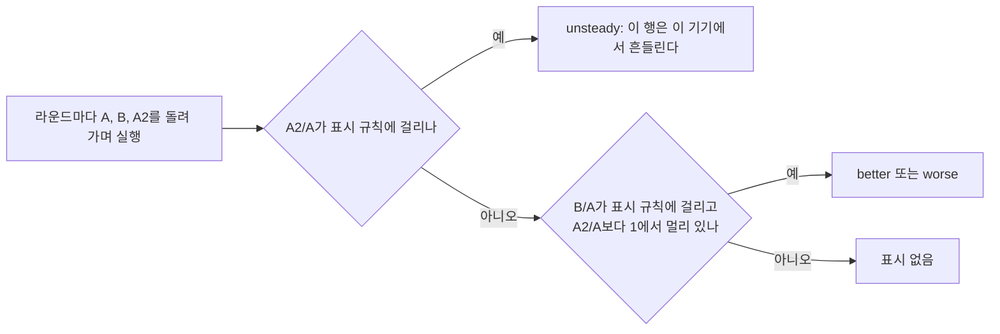

# #59 설계 : 작은 후속 정리 / #59 design : small follow-ups

이슈: [#59](https://github.com/reexec/rex86/issues/59) | 지시서: [20261013-i059](../work-orders/20261013-i059-small-follow-ups.md) | 로그: [20261013-i059](../work-logs/20261013-i059-small-follow-ups.md)

## 범위 / Scope

앞 작업들의 로그에 남은 후속 후보를 모았다. 그 가운데 Node 24 action, libFuzzer 작업의 ctest, `GuestMemory` null base는 이미 #37 후속에서 끝났다. 그래서 이 작업에는 넣지 않는다. 남은 것은 다음 다섯이다.

| 항목 | 출처 | 결정 |
|---|---|---|
| 견고성 하네스의 시간 감시 | [분석](../analysis/robustness-fuzz.md) 4절 미확정 | 1 |
| 비교 페이지의 A/A 대조 | [#52 로그](../work-logs/20261011-i052-pages-browser-tests.md) 배포 뒤 절 | 2 |
| Ubuntu 26.04 러너 | actions/runner-images#14748(이번 CI의 경고) | 3 |
| README 소비자 예시의 tag | README `GIT_TAG v0.0.2` | 4 |
| #53 작업 로그의 캠페인 결과 | #53 후속 | 4 |

*The follow-up candidates earlier logs left, minus those #37's follow-up already finished (Node 24 actions, ctest in the libFuzzer job, the `GuestMemory` null base): a watchdog in the robustness harness (analysis section 4, decision 1), an A/A control on the compare page (#52's log, decision 2), Ubuntu 26.04 runners (actions/runner-images#14748, warned in this CI, decision 3), and the README's tag with #53's campaign results (decision 4).*

## 결정 1: 견고성 하네스의 시간 감시 / Decision 1: a watchdog in the robustness harness

케이스 하나는 Run 24번 이하, Run마다 단계 예산 2만 이하로 묶여 있다. 그래서 코어가 계약대로 단계를 세면 하네스는 반드시 끝난다. 끝나지 않는 경우는 코어가 단계를 세지 않고 도는 결함뿐이다(#44에서 실제로 한 번 일어났다). 이 결함은 위반 줄이 아니라 시간 초과로 드러나고, 어느 시드였는지는 남지 않는다.

- **두 번째 스레드가 감시한다.** `rex86_robust`가 케이스를 시작할 때마다 `Watchdog::Enter(seed)`로 세대를 하나 올린다. 감시 스레드는 같은 세대가 상한(기본 60초)을 넘기면 `VIOLATION seed=<S>: watchdog: ...`와 `[rex86-robust] result=fail`을 적고 `std::_Exit(1)`로 끝낸다. 멈춘 스레드는 되돌릴 수 없으므로 프로세스를 끝내는 것이 유일한 답이다. 캠페인의 `fuzz_campaign.sh`는 이 줄을 결과 줄로 읽는다.
- **단계 수 상한은 두지 않는다.** Run의 단계 예산이 이미 그 상한이고(I5), 예산을 지키지 않는 결함이 바로 감시할 대상이다.
- **상한은 `--case-seconds N`**(0이면 끔)이다. 정상 케이스는 ASan Debug에서도 1초를 넘지 않으므로 60초는 거짓 경보 없이 넉넉하다.
- **wasm32에는 없다.** pthread 없는 Emscripten 빌드에는 두 번째 스레드가 없다. 거기서는 캠페인 작업의 시간 제한이 시드 없이 잡는다. libFuzzer 대상은 이미 `-timeout`이 있다.
- **시험**: `--test-stall-ms`(시험용)가 첫 케이스 안에서 잠든다. ctest `rex86_robust_watchdog`이 `--case-seconds 1 --test-stall-ms 3000`으로 돌려 위반 줄을 확인한다. wasm32에는 등록하지 않는다.

*A case is bounded (at most 24 Runs, each with a budget up to 20,000 steps), so a core counting steps as contracted always lets the harness end; only a defect looping without counting steps does not (#44 met one), showing as a timeout without the seed. A second thread watches: each case start calls `Watchdog::Enter(seed)`, raising a generation, and a generation unchanged past the limit (60 s by default) prints `VIOLATION seed=<S>: watchdog: ...` and `[rex86-robust] result=fail` and ends the process with `std::_Exit(1)`, the stuck thread being beyond reach; `fuzz_campaign.sh` reads that as the result line. No step limit: the Run budget is one (I5), and a defect that ignores it is the watchdog's target. `--case-seconds N` sets the limit (0 for off); normal cases stay under a second even in ASan Debug, so 60 s gives no false alarms. Not on wasm32: Emscripten without pthreads has no second thread, the campaign job's time limit catching it there without the seed, and the libFuzzer target already has `-timeout`. Test: `--test-stall-ms` (for tests) sleeps inside the first case, and ctest `rex86_robust_watchdog` runs `--case-seconds 1 --test-stall-ms 3000` expecting the violation line, not registered on wasm32.*

## 결정 2: 비교 페이지의 A/A 대조 / Decision 2: an A/A control on the compare page

#52의 표시 규칙(±5%를 넘고 두 쪽의 실행값 범위가 갈라짐)은 두 쪽의 실행이 서로 바꿔도 같은 분포라는 가정에 기댄다. 배포 뒤 실제 브라우저 세션에서는 이 가정이 깨져 거짓 표시가 나왔다(Edge, wasm call 1.083). 같은 세션의 A/A를 사람이 따로 돌려 함께 읽으라는 것이 가이드의 권고였다. 이것을 페이지가 직접 한다.

- **세 번째 쪽 A2**: 버전 A를 한 번 더 돌린다. 기본으로 켠다(체크박스와 `control=0|1`). 실행이 1.5배가 된다(기본 설정의 휴대폰에서 20번 → 30번).
- **순서**: 두 쪽일 때는 #52의 ABBA를 그대로 쓴다. 세 쪽은 라운드마다 한 칸씩 돌린다(ABA2, BA2A, A2AB, …). 그래서 각 쪽이 각 자리를 번갈아 맡는다.
- **판정**: `contrast(기준, 비교)`가 중앙값 비율, 범위가 갈라졌는지, 표시 색을 낸다. A2/A가 표시 규칙에 걸리면 그 행은 `unsteady`(기울임, 경고색)다. 그렇지 않으면 B/A가 규칙에 걸리고 |log(B/A)| > |log(A2/A)|일 때만 색을 칠한다.
- **표와 보고**: 표에 A2/A 열이 생긴다. 보고 줄에 `control=on|off`, 워크로드마다 `a2_mips= control_ratio= control_separate= mark=better|worse|unsteady|none a2_runs=`가 붙는다. 기존 키는 그대로 둔다.
- **루트와 버전 디렉터리의 계약은 그대로다.** 루트가 같은 `worker.js`를 한 번 더 부를 뿐이다. 그래서 이전 버전 디렉터리도 그대로 비교할 수 있다.
- **CI smoke**: `drive_pages.mjs`에 `--control on|off`(기본 on)를 더한다. 통과한 비교에서 모든 워크로드 줄에 `control_ratio`가 있는지(끄면 없는지) 확인한다.

*#52's marking rule (past ±5% with the sides' runs separate) assumes runs are exchangeable between sides, which a real browser session broke after deployment (Edge, wasm call 1.083); the guide advised running a same-session A/A by hand and reading the two together, and the page now does it. A third side, A2, runs version A again, on by default (a checkbox and `control=0|1`), making 1.5 times the runs (30 instead of 20 on a phone at the defaults). Two sides keep #52's ABBA; three rotate one place a round (A B A2, B A2 A, A2 A B, ...), so each side takes each place in turn. `contrast(base, other)` gives the median ratio, whether the ranges separate and the tone; a row whose A2/A meets the rule shows as `unsteady` (italic, warning color), and otherwise B/A is colored only when it meets the rule and |log(B/A)| > |log(A2/A)|. The table gains an A2/A column; the report adds `control=on|off` and per workload `a2_mips= control_ratio= control_separate= mark=better|worse|unsteady|none a2_runs=`, existing keys kept. The root-to-version-directory contract does not change, the root only calling the same `worker.js` once more, so earlier version directories compare as before. CI smoke: `drive_pages.mjs` gains `--control on|off` (default on) and checks that every workload line of a passing comparison carries `control_ratio` (none when off).*

## 결정 3: Ubuntu 26.04 러너 / Decision 3: Ubuntu 26.04 runners

`ubuntu-latest`는 2026-10-19부터 11-19까지 몇 주에 걸쳐 Ubuntu 26.04로 옮겨 간다(actions/runner-images#14748). 그 사이에는 같은 워크플로라도 실행마다 이미지가 다를 수 있다. 캠페인 결과의 러너 정보에 이미지까지 섞이면 실패를 읽기 어렵다.

- **라벨을 명시한다.** 세 워크플로의 `ubuntu-latest`를 `ubuntu-26.04`로, `ubuntu-24.04-arm`을 `ubuntu-26.04-arm`으로 바꾼다. 다음 이미지 전환은 라벨을 바꾸는 작업으로 다룬다.
- **확인됨**(이 브랜치의 CI, 이미지 `ubuntu26/20260927.149`, arm64 `20260927.135`, 커널 7.0.0-1012-azure): GCC 15.2.0, Clang 21.1.8에서 `-Werror` 빌드와 모든 ctest가 통과했다. 브라우저 셋(Playwright)과 캠페인 smoke(정수 i386 multilib 포함)도 통과했다. 실패한 것은 i386 Debian 컨테이너 하나뿐이다.
- **i386 컨테이너**: apt가 저장소에 닿지 못했다(`Temporary failure resolving 'deb.debian.org'`). `--network host`로도 같았다. 진단으로 원인을 좁혔다.
  - amd64 `debian:bookworm`은 기본 seccomp에서 이름 풀이와 TCP 연결이 모두 된다.
  - i386 `i386/debian:bookworm`은 기본 seccomp에서 bash의 `/dev/tcp` 연결이 `Function not implemented`(ENOSYS)로 실패한다.
  - 같은 i386 컨테이너를 `--security-opt seccomp=unconfined`로 띄우면 둘 다 된다.
  - 따라서 이 이미지(Docker 29.4.2)의 기본 seccomp 프로필이 i386 프로세스의 소켓 시스템 호출을 막는다. 커널의 32비트 호환 자체는 정상이다(호스트의 `-m32` 정수 fuzz가 통과한다).
- **결정**: CI의 i386 컨테이너를 `--security-opt seccomp=unconfined`로 띄운다. 이 저장소의 빌드와 시험만 도는 일회용 컨테이너이므로 seccomp를 풀어도 잃는 것이 없다. 프로필을 따로 두는 것보다 단순하다.

*`ubuntu-latest` moves to Ubuntu 26.04 over several weeks from 2026-10-19 to 11-19 (actions/runner-images#14748), during which one workflow may get different images run to run, mixing images into the campaign's runner details. Labels are named: `ubuntu-latest` becomes `ubuntu-26.04` and `ubuntu-24.04-arm` becomes `ubuntu-26.04-arm` in all three workflows, the next image change being a label change. Confirmed on this branch's CI (image `ubuntu26/20260927.149`, arm64 `20260927.135`, kernel 7.0.0-1012-azure): GCC 15.2.0 and Clang 21.1.8 pass the `-Werror` builds and every ctest, and the three browsers (Playwright) and the campaign smoke (i386 multilib included) pass; only the i386 Debian container failed, apt reaching no repository (`Temporary failure resolving 'deb.debian.org'`), the same with `--network host`. Diagnosis: amd64 `debian:bookworm` resolves and connects under the default seccomp; i386 `i386/debian:bookworm` fails bash's `/dev/tcp` connect with `Function not implemented` (ENOSYS) under it, and both work with `--security-opt seccomp=unconfined`; so this image's Docker (29.4.2) default seccomp profile blocks an i386 process's socket calls, the kernel's 32-bit compatibility being fine (the host's `-m32` integer fuzz passes). Decision: CI runs the i386 container with `--security-opt seccomp=unconfined`; a throwaway container running only this repository's build and tests loses nothing by it, and it is simpler than a separate profile.*

## 결정 4: README와 #53 기록 / Decision 4: the README and #53's record

- README의 소비자 예시를 `GIT_TAG v0.0.28`로 고치고, 캠페인이 녹색인 tag를 쓰라는 문장과 캠페인 결과가 있는 곳을 더한다.
- #53 작업 로그에 v0.0.27과 v0.0.28 캠페인 결과를 날짜별 절로 더한다. v0.0.28 캠페인에서 int-i386 warmup-0이 AMD EPYC 9V45(Zen 5)에서 돌아, 넓힌 CMPS 판정(#53 결정 1)이 처음 Zen 5에서 확인되었다.

*The README's consumer example pins `GIT_TAG v0.0.28` and says to use a tag whose campaign is green and where the result is; #53's work log gains a dated section with v0.0.27's and v0.0.28's campaigns, v0.0.28's int-i386 warmup-0 having run on an AMD EPYC 9V45 (Zen 5), the first Zen 5 run of the widened CMPS judgment (#53 decision 1).*

## 검증 / Verification

* 시간 감시: x86-64 GCC Debug ctest(새 `rex86_robust_watchdog` 포함), GCC TSan 빌드에서 감시 발동과 평소 실행, CI의 모든 호스트.
* A/A 대조: 조립한 Pages 사이트에서 `drive_pages.mjs`를 대조를 켜고 끄고, 버전 불일치까지 돌린다(Chromium). CI `browsers`의 smoke.
* 러너: 이 브랜치의 CI와 캠페인 smoke가 Ubuntu 26.04에서 녹색이다.

*Watchdog: x86-64 GCC Debug ctest with the new `rex86_robust_watchdog`, a GCC TSan build both firing and running normally, and CI on every host. A/A control: `drive_pages.mjs` on an assembled Pages site with the control on, off and against a mismatched version (Chromium), and CI `browsers`' smoke. Runners: this branch's CI and campaign smoke green on Ubuntu 26.04.*

## 소비자 영향 / Consumer impact

코어와 공개 계약은 바뀌지 않는다. re2DJ의 CI와 릴리스도 같은 `i386/debian:bookworm` 컨테이너를 `ubuntu-latest`에서 쓴다. 다만 이미 `--security-opt seccomp=unconfined`로 띄운다. 게스트가 쓰는 `modify_ldt`를 기본 프로필이 막기 때문이다. 그래서 이 문제를 만나지 않는다.

*The core and the public contract do not change. re2DJ's CI and release use the same `i386/debian:bookworm` container on `ubuntu-latest`, but already with `--security-opt seccomp=unconfined`, the default profile refusing the guest's `modify_ldt`, so they do not meet this.*
