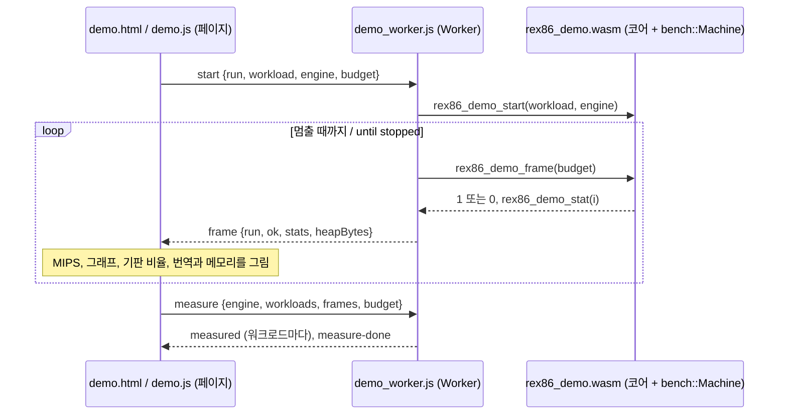

# #62 설계 : 웹 데모 페이지 / #62 design : the web demo page

이슈: [#62](https://github.com/reexec/rex86/issues/62) | 지시서: [20261013-i062](../work-orders/20261013-i062-web-demo.md) | 로그: [20261013-i062](../work-logs/20261013-i062-web-demo.md) | 근거: README 목표 5, 6, 7, [#48 설계](20261011-i048-browser-validation.md), [#52 설계](20261011-i052-pages-browser-tests.md)

## 목표 / Goal

README 목표 5의 공개 예제다. 브라우저에서 주소만 열면 wasm으로 빌드한 코어가 합성 게스트 워크로드를 실행한다. 엔진 선택, retire 수, 처리량을 화면에 보이고, 벤치마크 지표를 같은 페이지에서 재현한다. 목표 6(견고성)은 #31, #37로 이미 성립했다. 이것이 공개의 전제 조건이었다.

지금의 Pages 사이트(#52)는 시험 모음과 벤치마크를 돌리는 보고서 화면이다. 결과는 끝나야 나오고, 사람이 보며 조작할 수 없다. 데모는 실행 중의 코어를 그대로 보여 준다.

*README goal 5's public example: opening a page runs the wasm-built core on a synthetic guest workload, showing the engine choice, retired counts and throughput and reproducing the benchmark figures on the same page. Goal 6 (robustness), its precondition for publication, already holds (#31, #37). Today's Pages site (#52) is a report screen running the suites and the benchmark, with results only at the end and nothing to steer; the demo shows the core as it runs.*

## 결정 1: 데모 엔진은 벤치마크의 기계를 쓴다 / Decision 1: the demo engine is the benchmark's machine

`rex86_demo`는 Emscripten에서만 빌드하는 모듈 팩토리(`createRex86Demo`, `-sMODULARIZE`)다. C 함수 여섯을 낸다.

| 함수 / function | 하는 일 / does |
|---|---|
| `rex86_demo_info()` | JSON: 버전, 워크로드, 엔진, 기판 넷, 통계 이름 |
| `rex86_demo_start(workload, engine)` | `bench::Machine`을 만든다. 엔진은 0 인터프리터, 1 wasm, 2 평가기. 원한 엔진이 실제로 돌 때만 1 |
| `rex86_demo_frame(budget)` | `Machine::RunFrame` 한 번. 끝난 바퀴가 모두 참조 모델과 맞으면 1 |
| `rex86_demo_stat(i)` | 마지막 프레임 뒤의 값: retire, 바퀴, 프레임 ms, 번역 통계, 엔진 메모리, wasm 설치 통계 |
| `rex86_demo_failure()`, `rex86_demo_stop()` | 실패 이유, 기계 해제 |

- **같은 기계, 같은 프레임**: 벤치마크의 `bench::Machine`과 `RunFrame`을 그대로 쓴다. 그래서 데모의 프레임 하나가 `rex86_bench`의 프레임 하나와 같고, 수치를 재현할 수 있다. 바퀴마다 C++ 참조 모델과 맞춰 보는 것도 같다. 틀린 결과는 속도로 치지 않는다.
- **런타임 유지**: 브라우저 구성은 도구의 종료 코드를 페이지에 전하려고 `-sEXIT_RUNTIME=1`로 링크한다. 데모는 `main`이 없고 `-sEXIT_RUNTIME=0`으로 덮어써 호출 사이에 런타임이 살아 있다.
- **wasm 설치**: `WebWasmModuleServices`(동기 설치)를 쓴다. Worker에서는 큰 모듈도 동기로 컴파일할 수 있다(#45). 메인 스레드의 비동기 어댑터(#48)는 쓰지 않는다.
- 순수 Emscripten 구성(Node)에서도 빌드해 ctest `rex86_demo_smoke`로 확인한다.

*`rex86_demo` is a module factory built by Emscripten alone (`createRex86Demo`, `-sMODULARIZE`), exporting six C functions: `rex86_demo_info` (JSON with the version, workloads, engines, the four boards and the statistic names), `rex86_demo_start` (makes a `bench::Machine`, engine 0 interpreter, 1 wasm, 2 evaluator, returning 1 only when the engine asked for really runs), `rex86_demo_frame` (one `Machine::RunFrame`, 1 when every lap that ended matched the reference model), `rex86_demo_stat` (the values after the last frame: retired, laps, frame ms, translation statistics, engine memory, wasm installation counts), `rex86_demo_failure` and `rex86_demo_stop`. Being the benchmark's `bench::Machine` and `RunFrame`, a demo frame is a `rex86_bench` frame, so the figures reproduce, and laps are checked against the C++ reference model alike: a wrong result never counts as speed. The browser configuration links tools with `-sEXIT_RUNTIME=1` to hand exit codes to the page; the demo has no `main` and overrides it with `-sEXIT_RUNTIME=0`, keeping the runtime up between calls. Wasm installation uses `WebWasmModuleServices` (synchronous), which a Worker allows for large modules too (#45), not the main thread's asynchronous adapter (#48). The pure Emscripten configuration (Node) builds it as well, checked by ctest `rex86_demo_smoke`.*

## 결정 2: Worker가 돌리고 페이지는 그린다 / Decision 2: the Worker runs, the page draws

- **`demo_worker.js`**: `worker.js`처럼 자기 디렉터리의 `bin/`에서 모듈을 읽는다. `start`를 받으면 프레임을 하나 돌리고 통계를 보낸 뒤 `setTimeout(0)`으로 이벤트 고리에 차례를 넘긴다. 그래서 `stop`과 새 `start`가 끼어들 수 있다. 명령마다 세대를 올려 앞선 고리를 끝낸다. `start`의 `run` 번호를 프레임 메시지에 되돌려 보내고, 페이지는 다른 번호의 늦은 프레임을 버린다.
- **`demo.html`, `demo.js`**: 워크로드, 엔진(기본 wasm), 프레임당 단계(기본 100만, 벤치마크와 같음)를 고른다. 다음을 보인다.
  - MIPS(최근 1초, 시작 이후), 프레임 시간, retire한 단계, 검증된 바퀴, 번역이 돌린 단계의 비율, 최근 120프레임의 MIPS 그래프.
  - 기판 넷 기준 실시간 비율과 기판 한 프레임의 시간(IPC 1.0 가정, #27 결정 4).
  - 번역 통계(블록, 실행, 인터프리터로 넘긴 수, 모듈, 축출, 코드 변경으로 버린 번역)와 메모리.
- **측정 모드**: 고른 엔진으로 모든 워크로드를 정한 프레임 수(기본 20)만큼 돌린다. MIPS는 프레임 시간의 합으로, 첫 프레임은 기계를 만든 때부터 잰다. 둘 다 `rex86_bench`와 같다. p50, p99는 벤치마크와 같은 백분위 정의다.
- **보고**: `[rex86-demo]` 줄(사용자 에이전트, 버전과 메모리, 실시간 실행, 워크로드마다 측정)을 **Copy report**로 복사한다. 결과는 페이지에만 남는다.
- **CI용 질의**: `workload=`, `engine=`, `budget=`, `frames=N`(N 프레임 뒤 멈춤), `autostart=1`, `measure=1`, `mframes=`. `window.rex86Demo`에 상태를 둔다.
- 화면은 #52의 페이지와 같은 색 토큰과 어두운 테마를 쓰고, 휴대폰 폭에서 한 줄로 접힌다.

*`demo_worker.js` reads the module from its directory's `bin/` as `worker.js` does; on `start` it runs a frame, posts the statistics and yields with `setTimeout(0)`, so `stop` or a new `start` can come in, every command raising a generation that ends the earlier loop; frame messages echo `start`'s `run` number and the page drops late frames of another. `demo.html` and `demo.js` pick the workload, the engine (default wasm) and the steps per frame (default a million, as the benchmark), and show MIPS (the last second and since start), frame time, retired steps, verified laps, the share of steps run translated and a graph of the last 120 frames' MIPS; the real-time ratio and one board frame's time against the four boards (IPC 1.0 assumed, #27 decision 4); translation statistics (blocks, runs, exits to the interpreter, modules, evictions, translations dropped because code changed) and memory. Measurement mode runs every workload with the chosen engine for the frames chosen (default 20), MIPS from the sum of frame times and the first frame from the machine's construction, both as `rex86_bench`, with its percentile definition for p50 and p99. **Copy report** copies `[rex86-demo]` lines (user agent, version and memory, the live run, one per measured workload); results stay on the page. CI's query: `workload=`, `engine=`, `budget=`, `frames=N` (stop after N frames), `autostart=1`, `measure=1`, `mframes=`, with state in `window.rex86Demo`. The page shares #52's color tokens and dark theme and folds to one column at phone width.*

## 결정 3: 배포는 버전 디렉터리, 링크는 루트 / Decision 3: version directories carry it, the root links it

- 데모 파일 셋은 `tests/host/web/`에 둔다. `pages_site.mjs`의 실행기 파일 목록에 들어가 버전 디렉터리마다 그 버전의 빌드와 함께 올라간다. 페이지는 자기 버전의 코어만 돌린다.
- `versions.json`의 항목에 `demo`(그 디렉터리에 `demo.html`이 있는가)를 더한다. 루트 목록은 그 표시로 버전마다 **Demo** 링크를 걸고, 가장 새 데모 버전을 맨 위 **Run the demo**로 건다. 옛 항목에는 표시가 없어 링크가 생기지 않는다.
- 루트와 버전 디렉터리 사이의 계약(#52 결정 4)은 늘지 않는다. 루트는 데모 파일을 실행하지 않고 링크만 한다.

*The three demo files live in `tests/host/web/`, so `pages_site.mjs`'s runner file list carries them into each version directory with that version's build, the page running only its own version's core. `versions.json` entries gain `demo` (whether the directory has `demo.html`); the root list links **Demo** per version by it and the newest such version as **Run the demo** on top, older entries lacking the mark and so the link. The root-to-version contract (#52 decision 4) does not grow: the root only links the demo, never runs its files.*

## 결정 4: 검증 / Decision 4: verification

- **Node**: `demo_smoke.cjs`가 모든 엔진과 워크로드에서 바퀴 하나가 끝날 때까지(100,000단계씩 최대 30프레임) 돌려 검증을 확인한다. 없는 워크로드를 거절하는지도 본다(ctest `rex86_demo_smoke`).
- **브라우저**: `drive_demo.mjs`를 CI `browsers`(Chromium, Firefox, WebKit)에서 돌린다. 세 엔진을 `mixed`로 12프레임씩 실시간으로 돌리고, wasm으로 모든 워크로드를 2프레임씩 측정한다.
- **Pages**: `drive_pages.mjs`가 버전에 데모가 있으면 그 디렉터리에서 데모가 돌고 루트가 링크하는지 본다(CI의 Pages smoke).
- **실기기**: 모바일 Chrome, iOS Safari는 배포 뒤 사용자가 가이드 5절로 잰다. 그 값으로 목표 7의 수치 상한(코어 모듈 크기, 힙, 코드 캐시)을 정한다. 이 작업에서는 페이지가 그 값을 보이고 보고 줄에 담는 데까지다.

*Node: `demo_smoke.cjs` runs every engine and workload until a lap ends (up to 30 frames of 100,000 steps) and checks it verified, and that an unknown workload is refused (ctest `rex86_demo_smoke`). Browsers: `drive_demo.mjs` in CI `browsers` (Chromium, Firefox, WebKit) runs `mixed` live on the three engines for 12 frames each and measures every workload on wasm for 2 frames. Pages: when a version has the demo, `drive_pages.mjs` checks that it runs from that directory and that the root links it (CI's Pages smoke). Real devices: mobile Chrome and iOS Safari are measured by the user after deployment through guide section 5, and those figures fix goal 7's numeric caps (core module size, heap, code cache); this task goes as far as the page showing them and carrying them in its report lines.*

## 소비자 영향 / Consumer impact

없다. 코어와 공개 계약은 바뀌지 않는다. 새 타깃 `rex86_demo`는 시험 도구 구성(`REX86_BUILD_TESTS`)의 Emscripten 빌드에만 생긴다.

*None: the core and the public contract do not change; the new target `rex86_demo` appears only in Emscripten builds of the test tool configuration (`REX86_BUILD_TESTS`).*
