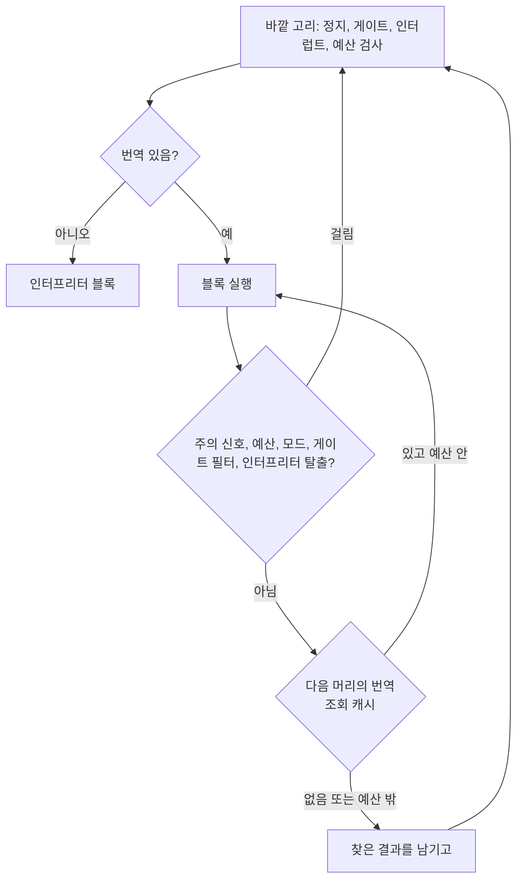

# #65 설계 : 번역 경로의 블록 비용, 디스패치 빠른 경로, 인라인 메모리 검사 / #65 design : the translation path's per-block cost, a dispatch fast path and inline memory checks

이슈: [#65](https://github.com/reexec/rex86/issues/65) | 지시서: [20261014-i065](../work-orders/20261014-i065-translation-dispatch.md) | 로그: [20261014-i065](../work-logs/20261014-i065-translation-dispatch.md) | 근거: [#42 설계](20261010-i042-phase3-translation.md) 결정 10, [#44 설계](20261010-i044-translation-runtime.md) 결정 1

## 결정 1: 측정 — 블록 하나의 비용 / Decision 1: measurement — one block's cost

#42 결정 10은 번역 경로의 최적화를 측정으로 고르라고 했다. 남은 후보는 블록 연결, 블록 안 레지스터 캐싱, 인라인 검사였다. 먼저 블록 하나에 시간이 어디서 쓰이는지 나눴다(호스트 F, Intel Core i5-7200U, WSL2, emsdk 6.0.8, Node 24.19.0, v0.0.31).

| 워크로드 | wasm MIPS | 블록당 명령 | 블록당 시간 |
|---|---:|---:|---:|
| alu | 49 | 9.0 | 약 180 ns |
| memory | 65 | 8.0 | 약 120 ns |
| call | 54 | 6.3 | 약 120 ns |

Node CPU 프로파일(`--profiling-funcs` 빌드, `--cpu-prof`, 40프레임, 자기 시간):

| 항목 | alu | memory | call |
|---|---:|---:|---:|
| 디스패치(`RunUntilStop`의 검사, `Translator::Lookup`, 통계. 링크 최적화로 `RunFrame`에 인라인되어 보임) | 42% | 36% | 32% |
| 블록 호출 래퍼 `WasmBackend::Run` | 7% | 6% | 6% |
| 메모리 검사 도우미(`CheckHelper`, `AccessWouldSucceed`, `call_indirect`) | — | 18% | 30% |
| 생성된 블록 본체 | 24% | 26% | 23% |

- **확인됨**: 범위 안의 코드에서 블록 본체는 4분의 1 남짓이다. 블록 사이의 디스패치가 가장 크고, 메모리를 쓰는 블록에서는 검사 호출이 그다음이다.
- **추정**: 디스패치 안의 내역(해시 조회, 세대 확인, 검사들)은 더 나누지 못했다. Emscripten의 링크 최적화(binaryen)가 `-fno-inline`과 상관없이 인라인하고 같은 함수를 합쳐 이름이 섞였다. 이 환경에 perf와 valgrind가 없고, 네이티브 `gprof`(평가기)는 평가기 본체가 대부분이라 wasm 경로의 비율을 대신하지 못했다. 그래서 고칠 때마다 전후를 번갈아 재서 효과를 본다.
- `mixed`는 시간 대부분이 인터프리터(x87, 인터프리터의 메모리 접근 경로)에 있어 이 작업의 대상이 아니다. `blocks`는 Zydis 디코드와 모듈 설치가 더해진다.

*#42 decision 10 asked for the translation path's optimizations to be chosen by measurement, leaving block linking, register caching within a block and inline checks; one block's time was split first (host F, Intel Core i5-7200U, WSL2, emsdk 6.0.8, Node 24.19.0, v0.0.31), as in the tables: alu at 49 MIPS with 9.0 instructions a block takes some 180 ns a block, memory and call some 120 ns; by Node's CPU profile (a `--profiling-funcs` build, `--cpu-prof`, 40 frames, self time) dispatch takes 42, 36 and 32% (the checks of `RunUntilStop`, `Translator::Lookup` and the statistics, seen inlined into `RunFrame` by the link-time optimizer), the `WasmBackend::Run` wrapper 7, 6 and 6%, the memory-check helper (`CheckHelper`, `AccessWouldSucceed`, `call_indirect`) 18 and 30% on memory and call, and the generated block body 24, 26 and 23%. Confirmed: inside the coverage the block body is about a quarter, dispatch between blocks the largest part and the check calls next where blocks touch memory. Inferred: dispatch could not be split further, binaryen inlining and merging functions whatever `-fno-inline` says, perf and valgrind being absent here and native `gprof` (the evaluator) dominated by the evaluator's body; so each change is measured before and after, interleaved. `mixed` spends most of its time in the interpreter (x87 and the interpreter's memory access) and is not this task's; `blocks` adds Zydis decoding and module installation.*

## 결정 2: 디스패치 빠른 경로 / Decision 2: a dispatch fast path

생성 코드는 그대로 두고, 블록 사이의 일을 줄인다.

- **안쪽 고리**(`Cpu::RunUntilStop`): 번역된 블록이 이어지는 동안 그 자리에서 다음 블록을 찾아 돌린다. 바깥 고리의 검사가 바뀔 수 있는 길은 넷뿐이다.
  - 정지 요청과 대기 인터럽트는 모두 주의 신호(attention)를 세운다.
  - 게이트는 필터(`GateFilter::MayContain`)가 표시한 머리에만 있을 수 있다.
  - 번역 블록은 인터럽트 그림자와 진행 중인 REP를 만들지 않는다.
  - 남은 것은 예산과 모드다.
  그래서 주의 신호, 예산, 모드(`ModesSupported`), 게이트 필터, 인터프리터 탈출 가운데 하나에 걸리면 바깥 고리로 돌아가 원래의 검사를 거친다. 게이트가 등록된 소비자도 빠른 경로를 쓴다.
- **조회는 한 번**: 안쪽 고리가 다음 머리를 찾았는데 번역이 없거나 예산을 넘으면, 그 결과를 바깥 고리에 넘긴다(같은 EIP일 때만 쓴다). 진입 횟수가 두 번 세어지지 않는다.
- **조회 캐시**(`Translator`): `entries_` 앞에 EIP로 바로 찾는 1,024칸 캐시를 둔다. 번역된 블록에 다시 들어오는 흔한 경우는 해시 없이 끝난다. 항목의 주소는 `Flush` 전까지 그대로이고, `Flush`가 캐시를 비운다. 맞은 칸도 상태가 `kTranslated`이고 세대가 그대로일 때만 쓴다. 묶음 제출(`Submit`)이 축출할 수 있으므로, 캐시 확인은 제출 뒤에 한다.
- **바뀌지 않는 것**: 예산(블록은 남은 예산이 덮을 때만 돈다), 게이트 검사, 인터럽트 전달 시점(블록 경계), 자기 수정 코드의 무효화(세대 확인), 통계. 생성 코드와 공개 계약은 그대로다.

*Generated code stays as it is; the work between blocks shrinks. The inner loop in `Cpu::RunUntilStop` runs the next translated block in place while translated blocks follow one another: the outer loop's checks can change only by four ways (a stop request and a pending interrupt both raise attention, a gate can only be at a head `GateFilter::MayContain` flags, a translated block makes no interrupt shadow and no REP in progress, leaving the budget and the modes), so attention, the budget, the modes (`ModesSupported`), the gate filter or an exit to the interpreter sends it back through the original checks, consumers with gates registered keeping the fast path. A head the inner loop looked up without a translation, or with one beyond the budget, hands its result to the outer loop (used only at the same EIP), so no entry is counted twice. A 1,024-slot cache indexed by EIP sits in front of `entries_` in `Translator`, so re-entering a translated block, the common case, skips the hash; an entry's address holds until `Flush`, which clears the cache, a hit is used only in `kTranslated` with its generations unchanged, and the cache is read after the batch submission, which can evict. Unchanged: the budget (a block runs only when the remaining budget covers it), gate checks, interrupt delivery at block boundaries, invalidation of self-modifying code (generation checks), the statistics, the generated code and the public contract.*

## 결정 3: 메모리 검사를 생성 코드 안에서 / Decision 3: memory checks inside the generated code

결정 2 뒤의 프로파일에서는 메모리 검사 도우미(`call_indirect` → `CheckHelper` → `AccessWouldSucceed`)가 call의 32%, memory의 17%로 가장 큰 덩어리가 되었다. 흔한 경우를 생성 코드 안에서 판단하고, 그 밖의 경우만 도우미가 판단한다.

- **빠른 판단**(`Generator::InlineCheck`): 아래가 모두 참일 때만 도우미를 부르지 않는다.
  - 세그먼트가 평탄(base 0, limit 0xFFFFFFFF)이고, 쓰기라면 쓰기 가능이다.
  - 범위가 메모리 안이다(`offset < size`이고 `size - offset ≥ bytes`).
  - 첫 페이지와 마지막 페이지가 모두 매핑되고 읽기(쓰기) 가능이며, 쓰기라면 둘 다 `kTranslated`가 아니다.
  이것은 `AccessWouldSucceed`를 흔한 경우에 대해 다시 쓴 것이고, 더 허용하는 일은 없다. 한 접근은 4096바이트보다 짧아 첫 페이지와 마지막 페이지가 겹치는 페이지 전부다. 하나라도 거짓이면 지금처럼 도우미가 판단하고, 실패하면 블록이 인터프리터로 나간다.
- **표를 읽는 순서**: 범위 확인이 참일 때만 페이지 속성 표를 읽는다(`if`). 범위 밖 주소로 표 너머를 읽어 wasm이 트랩하는 일이 없다.
- **검사 문맥**(`CheckContext`): 생성 코드는 속성 표의 주소와 메모리 크기를 백엔드가 가진 작은 구조체에서 읽는다. 그 구조체의 주소를 모듈에 상수로 넣고, `WasmBackend::Run`이 블록을 부르기 전에 두 값을 채운다. 함수 시그니처와 모듈 형식은 그대로다. 공개 계약에는 `PageAttributeTable::data()`(속성 바이트의 배열, 읽기 전용)를 더했다. wasm32가 아닌 호스트에서는 문맥 주소가 0이고 모든 검사가 도우미로 간다.
- **시험**: `WasmCheckTests`가 아홉 경우를 번역 실행과 인터프리터로 돌려, 이벤트(이유, 단계, 폴트 종류와 주소)와 상태, 메모리가 같은지 본다.
  - 정상 경로: 읽기, 쓰기.
  - 걸러져야 하는 경우: 읽기 전용 페이지, 다음 페이지가 매핑되지 않은 경계 걸침, 매핑되지 않은 읽기, 메모리 끝을 넘는 읽기, 번역된 코드 페이지에 쓰기, 평탄하지 않은 DS, 쓰기 불가 DS.

*After decision 2 the memory-check helper (`call_indirect` to `CheckHelper` and `AccessWouldSucceed`) became the largest part, 32% of call and 17% of memory, so the common case is judged inside the generated code and the helper judges the rest. `Generator::InlineCheck` skips the helper only when the segment is flat (base 0, limit 0xFFFFFFFF) and writable for a write, the range lies inside memory (`offset < size` and `size - offset ≥ bytes`), and the first and last pages are mapped and readable (writable), neither `kTranslated` for a write: `AccessWouldSucceed` restated for its common case and never more permissive, an access being shorter than 4,096 bytes so its first and last pages are all the pages it touches; anything else goes to the helper as before, a failure sending the block to the interpreter. The page flags are read only when the range check holds (an `if`), so an out-of-range address never reads past the table and traps. Generated code reads the flags' address and the memory size from a small structure the backend holds (`CheckContext`), whose address each module embeds as a constant and which `WasmBackend::Run` fills before calling a block; the function signature and the module format stay, and the public contract gains `PageAttributeTable::data()` (the read-only array of flag bytes); hosts other than wasm32 compile with a context address of 0, every check going to the helper. `WasmCheckTests` runs nine cases translated and interpreted and compares the events (reason, steps, fault kind and address), state and memory: the ordinary read and write, and those that must be filtered: a read-only page, a straddle into an unmapped page, an unmapped read, a read past the end of memory, a write into a translated code page, a non-flat DS and a non-writable DS.*

## 결과 / Results

호스트 F(Intel Core i5-7200U, WSL2, emsdk 6.0.8, Node 24.19.0). 측정 중 Windows 쪽의 다른 일(VS Code, Edge)로 부하 평균이 4~5였다. 부하는 시간을 늘리기만 하므로, 같은 설정을 번갈아 일곱 번 돌린 가장 좋은 값을 비교한다(wasm, 10프레임).

| 워크로드 | main(v0.0.31) | 결정 2와 3 | 변화 |
|---|---:|---:|---:|
| alu | 44.1 | 56.2 | +28% |
| memory | 28.7 | 39.3 | +37% |
| call | 25.6 | 43.4 | +69% |
| blocks | 1.91 | 1.87 | 같음 |
| mixed | 14.6 | 15.5 | +6% |

- **확인됨**: 결정 2만의 효과는 링크 최적화를 끈 프로파일에서 블록 본체의 몫으로 쟀다(본체의 일은 그대로이므로 몫이 커진 만큼 나머지가 준 것이다). 블록당 시간이 alu 22%, memory 21%, call 10% 줄었다. 결정 3 뒤에는 도우미가 프로파일에서 사라졌다.
- `blocks`는 블록 대부분이 한 번씩만 돌아 설치와 디코드가 지배하고, `mixed`는 인터프리터(x87, REP 문자열)가 지배해 이 작업의 효과가 작다.
- **남은 것**: 디스패치(`RunUntilStop`의 안쪽 고리와 `WasmBackend::Run`)가 call과 memory에서 아직 약 30%다. 이것을 더 줄이려면 블록 연결(생성 코드가 다음 블록을 직접 부름)이 필요하다. 후속 후보로 둔다.

*Host F (Intel Core i5-7200U, WSL2, emsdk 6.0.8, Node 24.19.0), with a load average of 4 to 5 from other work on Windows (VS Code, Edge) during the measurement; load only adds time, so the best of seven interleaved runs of each setting is compared (wasm, 10 frames), as in the table: alu +28%, memory +37%, call +69%, blocks unchanged, mixed +6%. Confirmed: decision 2 alone was measured by the block body's share in profiles with link-time optimization off (the body's work unchanged, so its share grows as the rest shrinks), one block's time falling by 22% on alu, 21% on memory and 10% on call; after decision 3 the helper is gone from the profile. `blocks` runs most blocks once, so installation and decoding dominate, and `mixed` is dominated by the interpreter (x87, REP strings), so this work moves them little. Remaining: dispatch (`RunUntilStop`'s inner loop and `WasmBackend::Run`) is still some 30% on call and memory; reducing it further takes block linking (generated code calling the next block directly), left as a follow-up candidate.*

## 검증 / Verification

* 정확성: 단위 테스트와 ctest(네이티브, wasm32), 번역 강제 빌드(평가기, wasm)의 전체 ctest, CI의 새니타이저 작업과 브라우저 셋. 번역 실행기 단위 테스트(묶음, 축출, 무효화)가 캐시 앞의 상태 변화를 지나고, `WasmCheckTests`가 인라인 검사의 경계를 본다. IR 차등의 wasm 비교와 견고성 I8(번역 강제 빌드)이 무작위 접근을 인터프리터와 맞춘다.
* 성능: main과 이 작업을 번갈아 세 번씩, wasm(Node)과 네이티브 평가기에서 alu, memory, call, mixed, blocks.

*Correctness: unit tests and ctest (native, wasm32), the whole ctest in forced-translation builds (evaluator, wasm), and CI's sanitizer jobs and three browsers, the runtime unit tests (batches, eviction, invalidation) passing state changes in front of the cache. Performance: main against this work three times interleaved, on wasm (Node) and the native evaluator, over alu, memory, call, mixed and blocks.*

## 소비자 영향 / Consumer impact

결과는 그대로이고, 번역이 켜진 소비자에서 블록 사이와 메모리 접근의 비용이 준다. 공개 계약에는 두 가지가 바뀐다. 둘 다 소스 호환이다.

- `PageAttributeTable::data()`가 더해진다.
- `PageAttributeTable::Generation`이 헤더의 인라인 정의가 된다.

*Results stay, and consumers with translation on pay less between blocks and for memory accesses. The public contract changes in two ways, both source compatible: `PageAttributeTable::data()` is added, and `PageAttributeTable::Generation` becomes an inline definition in the header.*
